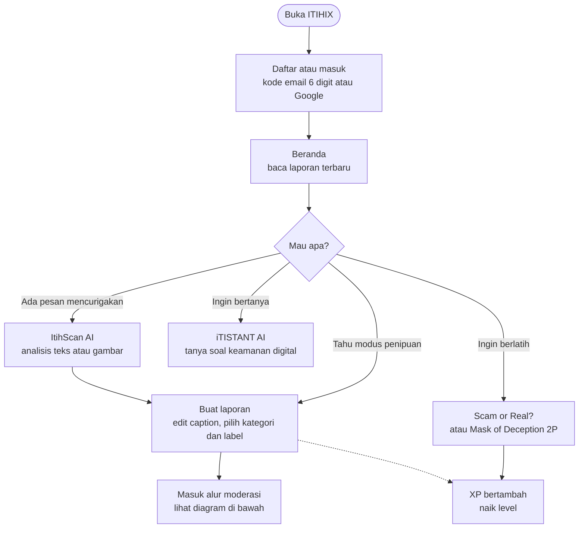
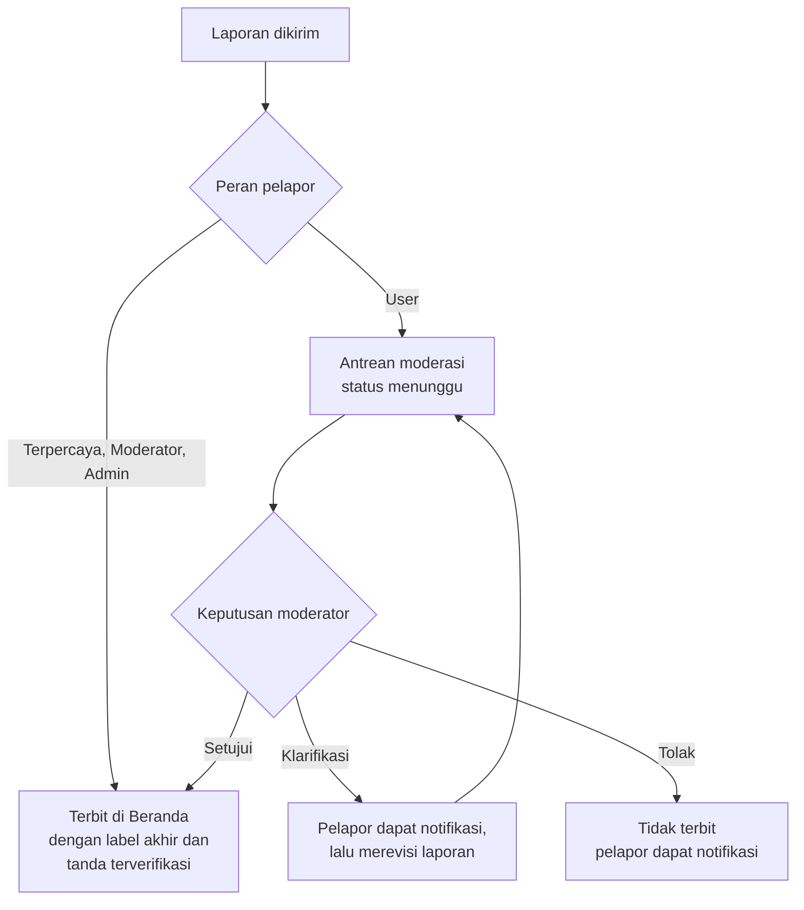
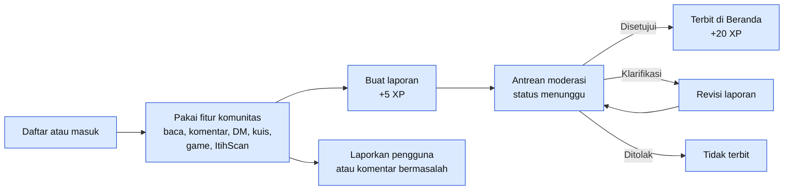
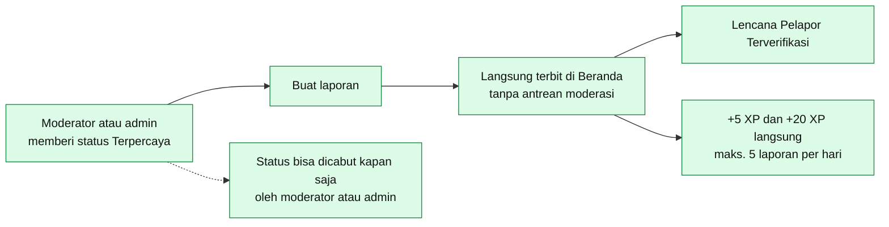
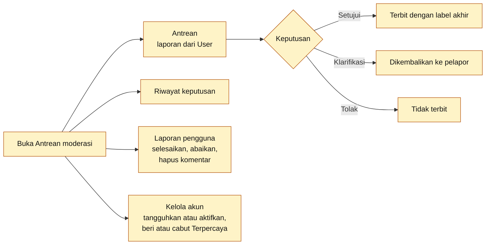
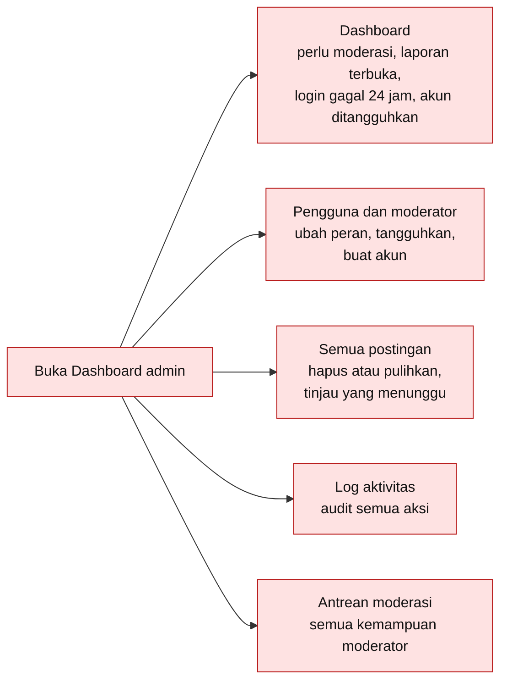
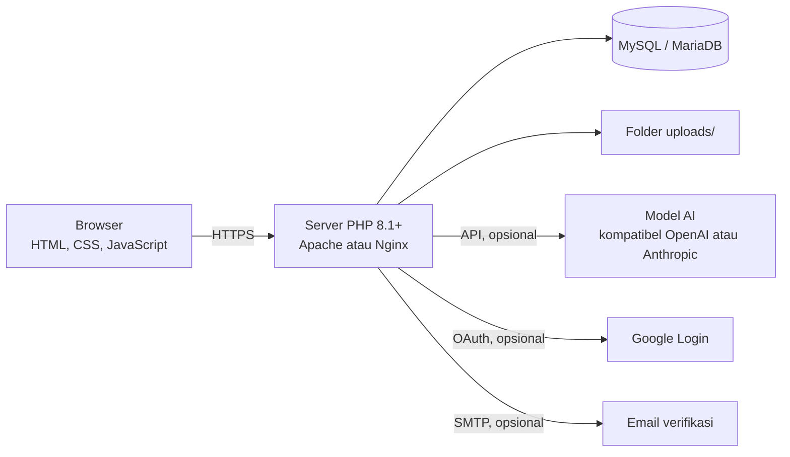

<div align="center">


# ITIHIX

**Navigasi aman di dunia digital.**
Komunitas yang saling mengabari penipuan terbaru, dilengkapi ItihScan AI untuk memeriksa pesan mencurigakan sebelum kamu terlanjur percaya.

[](https://itihix.my.id)


</div>

## Coba sekarang

| Versi | Cara buka |
|---|---|
| Website (sudah online) | [itihix.my.id](https://itihix.my.id) |
| Di komputer sendiri | Ikuti bagian [Menjalankan di komputer sendiri](#menjalankan-di-komputer-sendiri) |

Cukup buka website, daftar akun (atau masuk dengan Google), dan semua fitur bisa langsung dipakai. Ini versi uji coba, jadi jangan mengunggah data pribadi yang sensitif.


---

## Daftar isi

- [Coba sekarang](#coba-sekarang)
- [Kenapa ITIHIX dibuat?](#kenapa-itihix-dibuat)
- [Untuk siapa?](#untuk-siapa)
- [Fitur](#fitur)
- [Alur pemakaian](#alur-pemakaian)
- [Coba yuk ITIHIX!](#coba-yuk-itihix)
- [Cara kerjanya](#cara-kerjanya)
- [Teknologi](#teknologi)
- [Isi folder](#isi-folder)
- [Menjalankan di komputer sendiri](#menjalankan-di-komputer-sendiri)
- [Migrasi database](#migrasi-database)
- [Deploy](#deploy)
- [Keterbatasan](#keterbatasan)
- [Sumber daya pihak ketiga dan lisensi](#sumber-daya-pihak-ketiga-dan-lisensi)
- [Dokumentasi](#dokumentasi)
- [Tim](#tim)

---

## Kenapa ITIHIX dibuat?

Penipuan digital berkembang cepat: phishing lewat tautan palsu, telepon yang mengaku petugas bank, tawaran kerja yang meminta transfer dulu, sampai undian palsu. Modusnya selalu berganti, sementara kabar tentang modus terbaru biasanya cuma beredar di grup chat dan sering terlambat sampai ke orang yang akan jadi korban berikutnya.

Masalah yang kami lihat:

- Informasi penipuan tersebar di banyak tempat dan sulit dicari.
- Orang sering ragu: "ini penipuan atau bukan?" dan tidak tahu harus bertanya ke siapa.
- Edukasi keamanan digital terasa membosankan, jadi sedikit yang mau belajar sebelum kejadian.

Karena itu kami membuat ITIHIX: tempat warga saling melapor, saling memverifikasi, dan belajar mengenali penipuan. Laporan diperiksa moderator dan diberi label, sehingga pembaca tahu mana yang sudah terverifikasi. Kalau masih ragu, ItihScan AI bisa langsung menganalisis pesan atau gambar yang kamu terima.

## Untuk siapa?

- **Pengguna umum** yang ingin tahu modus penipuan terbaru dan cara menghindarinya.
- **Orang yang baru menerima pesan atau tawaran mencurigakan** dan butuh pendapat cepat sebelum bertindak.
- **Korban atau saksi penipuan** yang ingin melapor supaya orang lain tidak mengalami hal yang sama.
- **Pelajar dan keluarga** yang ingin belajar mengenali penipuan lewat kuis dan game.
- **Relawan moderator** yang ingin ikut menjaga kualitas informasi di komunitas.

---

## Fitur

<table>
<tr>
<td width="80" align="center" valign="top">


</td>
<td valign="top">

**Beranda (feed komunitas)**

Laporan penipuan terbaru dalam tiga tab: *Untuk kamu*, *Terbaru*, dan *Terverifikasi*. Setiap laporan bisa disukai, di-repost, disimpan, dibagikan, dan dikomentari.

</td>
</tr>
<tr>
<td width="80" align="center" valign="top">


</td>
<td valign="top">

**Jelajahi**

Cari laporan lewat top hashtag, kategori, jenis modus, atau pencarian. Label bisa diklik seperti hashtag.

</td>
</tr>
<tr>
<td width="80" align="center" valign="top">


</td>
<td valign="top">

**ItihScan AI**

Fitur unggulan. Tempel teks pesan atau unggah gambar (tangkapan layar chat, SMS, poster), lalu ItihScan menganalisisnya: apakah ini penipuan, mencurigakan, atau aman, lengkap dengan alasan dan langkah yang sebaiknya kamu lakukan. Hasilnya otomatis jadi caption yang bisa kamu edit lalu terbitkan sebagai laporan berlabel *ItihScan AI*. Tanpa API key AI, ItihScan tetap berjalan memakai mesin aturan lokal (deteksi kata kunci dan pola modus).

</td>
</tr>
<tr>
<td width="80" align="center" valign="top">


</td>
<td valign="top">

**iTISTANT (Chat AI)**

Asisten untuk bertanya soal keamanan digital, bisa melampirkan file atau gambar. Riwayat obrolan tersimpan.

</td>
</tr>
<tr>
<td width="80" align="center" valign="top">


</td>
<td valign="top">

**SafeSnaps**

Feed ringkas bergaya reels untuk konten edukasi dan peringatan. Unggahan masuk antrean moderasi lebih dulu.

</td>
</tr>
<tr>
<td width="80" align="center" valign="top">


</td>
<td valign="top">

**Laporan dan label**

Kirim laporan lengkap dengan kategori dan jenis modus. Satu laporan boleh punya beberapa label: **Penipuan**, **Mencurigakan**, **Klarifikasi**, dan **Edukasi**. Moderator memberi label akhir dan tanda "✓ Diverifikasi moderator". Laporan yang sudah dikirim bisa diedit.

</td>
</tr>
<tr>
<td width="80" align="center" valign="top">


</td>
<td valign="top">

**Kuis Scam or Real? (Asli/Palsu)**

Latihan membedakan pesan asli dan palsu bergaya chat WhatsApp, lengkap dengan penjelasan dan tanda bahayanya, plus streak dan riwayat.

</td>
</tr>
<tr>
<td width="80" align="center" valign="top">


</td>
<td valign="top">

**Mask of Deception 2P**

Game 2 pemain berbentuk chat: satu pemain berperan sebagai penipu atau bukan, pemain lain menebak. Ada pencarian lawan otomatis, ruangan publik atau privat, batas waktu tiap giliran, dan riwayat match.

</td>
</tr>
<tr>
<td width="80" align="center" valign="top">


</td>
<td valign="top">

**Profil, level, dan XP**

Setiap aktivitas menambah XP. Level maksimal 110 dengan gelar dari *Pemula Waspada* sampai *Legenda ITIHIX*. Ada profil, follow, pesan langsung (DM), notifikasi, dan pengaturan privasi.

</td>
</tr>
<tr>
<td width="80" align="center" valign="top">


</td>
<td valign="top">

**Akun**

Daftar dengan email (kode verifikasi 6 digit) atau Google, plus fitur lupa dan reset kata sandi.

</td>
</tr>
<tr>
<td width="80" align="center" valign="top">


</td>
<td valign="top">

**Moderasi dan admin**

Antrean moderasi (setujui, minta klarifikasi, atau tolak), dashboard admin, kelola pengguna dan peran, serta log aktivitas.

</td>
</tr>
</table>

### Peran

| Peran | Bisa apa |
|---|---|
| User | Semua fitur komunitas. Laporan masuk antrean moderasi. |
| Terpercaya (`trusted`) | Fitur user, tetapi laporannya **langsung terbit** tanpa antrean dan diberi lencana *Pelapor Terverifikasi*. XP "laporan disetujui" langsung didapat. |
| Moderator | Fitur user + antrean moderasi. Laporannya langsung terbit. Bisa memberi atau mencabut status Terpercaya pada user. |
| Admin | Fitur moderator + dashboard, kelola akun dan peran, hapus/pulihkan postingan, lihat seluruh log. |

Status Terpercaya diberikan oleh moderator atau admin lewat halaman profil pengguna atau halaman moderasi, dan bisa dicabut kapan saja.

### Level dan XP

XP untuk naik dari level L = `100 + 10×(L−1)`.

| Aktivitas | XP |
|---|---|
| Laporan terkirim | +5 (maks. 5/hari) |
| Laporan disetujui | +20 |
| Kuis benar | +10 sampai +20 |
| Analisis AI | +5 (maks. 5/hari) |
| Komentar | +2 (maks. 5/hari) |
| Moderasi | +2 |

Gelar: Pemula Waspada → Penjaga Komunitas (10) → Pelindung Siber (30) → Pakar Anti-Penipuan (60) → Tameng Digital (90) → Legenda ITIHIX (110).

### Keamanan

- Prepared statements PDO (anti SQL injection) dan `password_hash` untuk sandi.
- Token CSRF di semua permintaan POST.
- Validasi tipe MIME dan ukuran file upload; folder `uploads/` tidak bisa menjalankan PHP.
- Rate limit berbasis database per IP, pengguna, dan akun (login, chat, deteksi, komentar, laporan).
- `.htaccess` menolak akses ke `.env`, `.sql`, `.md`, dan folder internal lain, plus header keamanan.
- Cookie sesi `Secure` di HTTPS, soft-delete, dan log audit.

---

## Alur pemakaian

### Perjalanan pengguna



### Alur laporan dan moderasi



### Alur per peran

Peran bertambah dari kiri ke kanan: Terpercaya punya semua kemampuan User, Moderator menambah wewenang moderasi, dan Admin menambah pengelolaan seluruh sistem.

| Kemampuan | User | Terpercaya | Moderator | Admin |
|---|:---:|:---:|:---:|:---:|
| Baca, komentar, DM, kuis, game, ItihScan, iTISTANT | ✓ | ✓ | ✓ | ✓ |
| Mengirim laporan | ✓ | ✓ | ✓ | ✓ |
| Laporan langsung terbit (tanpa antrean) | – | ✓ | ✓ | ✓ |
| Lencana pada laporan | – | Pelapor Terverifikasi | Oleh Moderator | Oleh Admin |
| Meninjau antrean moderasi | – | – | ✓ | ✓ |
| Memberi atau mencabut status Terpercaya | – | – | ✓ | ✓ |
| Menangguhkan atau mengaktifkan akun | – | – | User dan Terpercaya | Semua akun |
| Menghapus postingan dan komentar orang lain | – | – | User dan Terpercaya | Semua |
| Menangani laporan pengguna dan komentar | – | – | ✓ | ✓ |
| Mengubah peran dan membuat akun | – | – | – | ✓ |
| Dashboard, semua postingan (hapus/pulihkan), log aktivitas | – | – | – | ✓ |

#### Alur User



#### Alur Terpercaya



#### Alur Moderator



Moderator hanya bisa mengelola akun User dan Terpercaya, tidak bisa menyentuh sesama moderator atau admin.

#### Alur Admin



### Menu di sidebar

| Kelompok | Menu | Fungsi |
|---|---|---|
| **Menu utama** | Beranda | Feed laporan (tab Untuk kamu, Terbaru, Terverifikasi) |
| | Jelajahi | Cari lewat hashtag, kategori, jenis modus |
| | SafeSnaps | Feed ringkas bergaya reels untuk edukasi dan peringatan |
| **Perlindungan Digital** | ItihScan AI | Periksa pesan atau gambar mencurigakan |
| | iTISTANT AI | Chat AI soal keamanan digital |
| | Scam or Real? | Kuis membedakan pesan asli dan palsu |
| | Mask of Deception 2P | Game tebak penipu untuk 2 pemain |
| **Komunitas** | Buat laporan | Kirim laporan penipuan |
| | Pesan | Pesan langsung (DM) |
| | Notifikasi | Pemberitahuan aktivitas |
| **Moderasi** | Antrean moderasi | Setujui, minta klarifikasi, atau tolak laporan (moderator dan admin) |
| | Dashboard admin | Kelola pengguna, peran, postingan, dan log (admin) |
| **Akun** | Profil saya | Profil, level, XP, dan riwayat |
| | Pengaturan | Privasi dan preferensi |
| | Keluar | Logout |

Kelompok **Moderasi** hanya tampil untuk moderator dan admin.

### Ringkasan langkah

1. Pengguna mendaftar atau masuk, lalu membaca laporan terbaru di **Beranda**.
2. Kalau menerima pesan mencurigakan, pengguna memeriksanya lewat **ItihScan AI**. Kalau hanya ingin bertanya, pakai **iTISTANT AI**. Untuk berlatih, ada **Scam or Real?** dan **Mask of Deception 2P**.
3. Hasil ItihScan otomatis menjadi caption laporan. Pengguna bisa mengeditnya, atau membuat laporan sendiri lewat **Buat laporan**.
4. Laporan dari User masuk **Antrean moderasi**. Laporan dari pengguna Terpercaya, Moderator, dan Admin langsung terbit.
5. Moderator memilih: **setujui** (laporan terbit dengan label akhir dan tanda terverifikasi), **minta klarifikasi** (pelapor merevisi, lalu laporan masuk antrean lagi), atau **tolak** (tidak terbit, pelapor diberi tahu).
6. Setiap aktivitas (laporan, kuis, game, komentar) menambah XP sehingga pengguna naik level.

## Coba yuk ITIHIX!

1. Buka [itihix.my.id](https://itihix.my.id), lalu **daftar** akun baru (email dikirimi kode 6 digit) atau masuk dengan Google.
2. Di **Beranda**, buka tab *Terverifikasi* untuk melihat laporan yang sudah diperiksa moderator.
3. Buka **ItihScan**, tempel pesan seperti *"Selamat! Anda menang undian Rp50 juta. Klik link ini dan transfer biaya admin"*, lalu lihat hasil analisis dan caption otomatisnya.
4. Edit caption, pilih kategori dan label, lalu kirim sebagai laporan. Laporan masuk antrean moderasi.
5. Di **Jelajahi**, coba cari lewat hashtag atau klik label *Penipuan*.
6. Coba **Kuis Scam or Real?** untuk mendapatkan XP, lalu ajak temanmu main **Mask of Deception 2P**.
7. Tanya **iTISTANT** hal seperti "Bagaimana cara tahu link bank palsu?".
8. Untuk mencoba `moderator.php` dan `admin.php`, ubah peran akunmu lewat database (lihat langkah 8 di bagian [Menjalankan di komputer sendiri](#menjalankan-di-komputer-sendiri)).

---

## Cara kerjanya



- Satu aplikasi PHP melayani halaman dan endpoint AJAX (`api/*.php`).
- API key dan kata sandi hanya ada di server (`.env`), tidak pernah dikirim ke browser.
- Data disimpan di MySQL. Perubahan skema dikelola lewat `migrations/`.
- Penyedia AI bisa diganti lewat `.env` (`AI_PROVIDER`, `AI_BASE_URL`, `AI_MODEL`) tanpa ubah kode. Tanpa API key, ItihScan dan Chat AI memakai mesin aturan lokal.

---

## Teknologi

| Bagian | Yang dipakai |
|---|---|
| Backend | PHP 8.1+ (PDO, cURL, mbstring, fileinfo), tanpa framework |
| Database | MySQL 5.7+ / MariaDB 10.3+ |
| Frontend | HTML, CSS, JavaScript murni (tanpa framework dan tanpa CDN) |
| AI | Model kompatibel OpenAI atau Anthropic (opsional) + mesin aturan lokal |
| Login dan email | Google OAuth 2.0 (opsional), SMTP (opsional) |

---

## Isi folder

```
itihix/
├── index.php, explore.php, safesnaps.php, safesnaps_upload.php,
│   detect.php, chat.php, quiz.php, game.php, post.php, edit_report.php,
│   upload.php, profile.php, settings.php, notifications.php,
│   messages.php                           Halaman utama aplikasi
├── login.php, register.php, verify_email.php, forgot_password.php,
│   reset_password.php, google_login.php, google_callback.php,
│   logout.php                             Autentikasi
├── moderator.php, admin.php               Moderasi dan administrasi
├── api/                                   Endpoint AJAX (reaksi, komentar, chat, deteksi, kuis, game, DM, dll.)
├── includes/                              Logika inti (bootstrap, ai, posts, mail, migrate, dll.)
├── assets/                                CSS, JavaScript, dan gambar
├── migrations/                            Riwayat perubahan skema database
├── uploads/                               File unggahan pengguna (isinya tidak ikut di Git)
├── docs/                                  Contoh konfigurasi Nginx, catatan CSS, dan ikon untuk README (docs/icons)
├── database.sql                           Skema database terbaru
├── config.php                             Konfigurasi utama (membaca .env)
├── config.local.php.example               Contoh konfigurasi lokal
├── migrate.php                            Menjalankan migrasi secara manual
└── .env.example                           Contoh isi .env
```

---

## Menjalankan di komputer sendiri

Yang kamu butuhkan:

- **XAMPP atau Laragon** (sudah termasuk PHP 8.1+, Apache, dan MySQL/MariaDB). Unduh di [apachefriends.org](https://www.apachefriends.org) atau [laragon.org](https://laragon.org).
- PHP dengan ekstensi `pdo_mysql`, `fileinfo`, `curl`, dan `mbstring` (sudah aktif di XAMPP/Laragon standar).
- (Opsional) API key AI, kredensial Google OAuth, dan akun SMTP.

### Langkah-langkah

1. **Unduh kodenya.** Di halaman repo GitHub, klik tombol hijau **Code**, lalu **Download ZIP**. Atau pakai git:

   ```bash
   git clone https://github.com/USERNAME/itihix.git
   ```

2. **Taruh di web root.** Ekstrak dan salin foldernya ke `htdocs` (XAMPP) atau `www` (Laragon), sehingga namanya `htdocs/itihix`.
3. **Nyalakan Apache dan MySQL** lewat panel XAMPP/Laragon.
4. **Buat database dan impor skema.** Buka `http://localhost/phpmyadmin`, buat database baru bernama `itihix` dengan collation `utf8mb4_unicode_ci`, pilih database itu, lalu **Import** file `database.sql`.
5. **Buat file `.env`.** Salin `.env.example` menjadi `.env`, lalu isi `ITIHIX_DB_USER`, `ITIHIX_DB_PASS`, dan `ITIHIX_BASE_URL` (di XAMPP biasanya user `root`, sandi kosong, base URL `/itihix`).
   - Windows: pastikan namanya benar-benar `.env`, bukan `.env.txt`.
   - **Lebih aman:** simpan sebagai `../itihix.env` (satu tingkat di atas folder aplikasi, di luar web root), atau tunjuk lewat variabel `ITIHIX_ENV_FILE`.
6. **Pastikan folder `uploads/` bisa ditulis** oleh web server.
7. Buka **http://localhost/itihix/** di browser, lalu daftar akun baru.
8. **(Opsional) Jadikan akunmu admin atau moderator** lewat phpMyAdmin, tab SQL:

   ```sql
   UPDATE users SET role = 'admin' WHERE email = 'emailkamu@contoh.com';
   ```

   Nilai peran yang tersedia: `user`, `trusted` (Terpercaya), `moderator`, `admin`.

### Isi file `.env`

```env
ITIHIX_DB_HOST=localhost
ITIHIX_DB_PORT=3306
ITIHIX_DB_NAME=itihix
ITIHIX_DB_USER=root
ITIHIX_DB_PASS=
ITIHIX_BASE_URL=/itihix

# AI (opsional; kosongkan AI_API_KEY = pakai mesin aturan lokal)
AI_PROVIDER=openai
AI_BASE_URL=https://api.openai.com/v1
AI_API_KEY=
AI_MODEL=

# Login Google (opsional)
GOOGLE_CLIENT_ID=
GOOGLE_CLIENT_SECRET=
GOOGLE_REDIRECT_URI=

# Email verifikasi (opsional)
SMTP_HOST=
SMTP_PORT=587
SMTP_SECURE=tls
SMTP_USER=
SMTP_PASS=
SMTP_FROM=
MAIL_DEV_LOG=0
```

| Nama | Fungsi | Wajib |
|---|---|---|
| `ITIHIX_DB_*` | Koneksi database | Ya |
| `ITIHIX_BASE_URL` | Folder URL aplikasi, tanpa slash di akhir. Kosongkan jika di root domain | Ya |
| `AI_API_KEY`, `AI_PROVIDER`, `AI_BASE_URL`, `AI_MODEL` | AI sungguhan untuk ItihScan dan Chat AI (nama lama `ANTHROPIC_*` tetap dikenali) | Tidak |
| `GOOGLE_*` | Login Google. Redirect URI = `https://DOMAIN/google_callback.php` (contoh di server kami: `https://itihix.my.id/google_callback.php`) | Tidak |
| `SMTP_*` | Kode verifikasi email. Untuk Gmail pakai *App Password* (butuh verifikasi 2 langkah) | Tidak |
| `MAIL_DEV_LOG` | `1` = kode verifikasi ditulis ke `includes/mail.log` (hanya untuk uji lokal) | Tidak |

**Jangan pernah membagikan atau meng-commit file `.env`**, karena isinya kata sandi dan API key. File ini sudah ada di `.gitignore`.

### Kalau ada masalah

| Masalah | Yang bisa dicoba |
|---|---|
| Halaman tidak ditemukan atau CSS tidak muncul | Cek `ITIHIX_BASE_URL` di `.env`, harus sama dengan nama folder (mis. `/itihix`). |
| Error koneksi database | Pastikan MySQL menyala, `database.sql` sudah diimpor ke database `itihix`, dan `ITIHIX_DB_USER` dan `ITIHIX_DB_PASS` benar. |
| Upload gambar gagal | Pastikan folder `uploads/` bisa ditulis dan ukuran file tidak terlalu besar. |
| Kode verifikasi email tidak sampai | Cek isi `SMTP_*`. Untuk uji lokal isi `MAIL_DEV_LOG=1`, lalu baca kodenya di `includes/mail.log`. |
| ItihScan hanya memberi jawaban singkat | `AI_API_KEY` kosong atau salah, jadi dipakai mesin aturan lokal. |

---

## Migrasi database

- Perubahan skema = tambah file `migrations/NNN_deskripsi.php` (idempoten), lalu naikkan `SCHEMA_VERSION` di `config.php`.
- Migrasi tertunda dijalankan otomatis (sekali per sesi baru) atau manual: `php migrate.php`.
- `database.sql` berisi skema terbaru untuk instalasi baru.
- Soal kuis tidak ada di `database.sql`; aplikasi menyiapkannya sendiri saat fitur kuis dipakai (`api/quiz.php`).

---

## Deploy

ITIHIX adalah aplikasi PHP + MySQL dengan file upload, jadi butuh hosting yang mendukung PHP dan database MySQL (shared hosting, VPS, atau container Docker PHP). Platform serverless seperti Vercel tidak cocok karena tidak menjalankan PHP secara native dan tidak menyimpan file upload secara permanen.

1. Buat database di hosting dengan **user khusus** (jangan `root`) dan sandi kuat, lalu impor `database.sql`.
2. Upload kode (tanpa `.env`).
3. Buat `.env` **langsung di server**, idealnya di luar web root sebagai `../itihix.env`. Pastikan `MAIL_DEV_LOG=0`.
4. Pastikan `uploads/` bisa ditulis dan `uploads/.htaccess` ikut ter-upload.
5. Aktifkan **HTTPS**. Jika memakai login Google, perbarui `GOOGLE_REDIRECT_URI` ke domain asli.
6. Untuk Nginx, pakai contoh pengaman di `docs/nginx.conf.example`.

---

## Keterbatasan

- Tanpa API key, ItihScan dan Chat AI memakai mesin aturan lokal yang lebih sederhana dan tidak sepintar model AI.
- Hasil analisis AI adalah **bantuan**, bukan kepastian. Selalu verifikasi lewat sumber resmi (bank, instansi, atau nomor resmi) sebelum mengambil tindakan.
- Penyedia AI punya batas permintaan, dan ITIHIX membatasi pemakaian per hari lewat rate limit.
- Pengiriman email bergantung pada konfigurasi SMTP (mis. Gmail App Password).
- Belum ada tes otomatis; alur utama (login, unggah, kuis, ItihScan) diuji manual.

---

## Sumber daya pihak ketiga dan lisensi

Penggunaan template, framework, library, aset, maupun kode sumber pihak ketiga dilakukan sesuai lisensi masing-masing. Sumber daya yang signifikan dicantumkan di bawah ini.

| Sumber daya | Kegunaan | Lisensi | Keterangan |
|---|---|---|---|
| PHP dan MySQL/MariaDB | Bahasa server dan basis data | PHP License / GPL | Runtime, bukan kode yang disalin |
| [Font Awesome Free 6](https://fontawesome.com) | Pustaka ikon. Ikon yang dipakai disalin sebagai SVG inline (`includes/icons.php`, `assets/js/icons.js`) | Ikon: [CC BY 4.0](https://fontawesome.com/license/free) | Atribusi: Font Awesome by Fonticons, Inc. Ikon dipilih sebagian dan diwarnai lewat `currentColor`. Ikon fitur di README (`docs/icons/*.svg`) juga berasal dari sini, diberi warna hitam dan latar putih |
| [Lucide](https://lucide.dev) | Pustaka ikon. Ikon yang dipakai disalin sebagai SVG inline di SafeSnaps (`safesnaps.php`) | [ISC](https://github.com/lucide-icons/lucide/blob/main/LICENSE) | Hak cipta: Lucide Contributors (dan Cole Bemis untuk bagian turunan Feather) |
| Google OAuth 2.0 / OpenID Connect | Login dengan Google (opsional) | Ketentuan layanan Google | Layanan eksternal via API |
| Penyedia AI kompatibel OpenAI atau Anthropic | ItihScan AI dan Chat AI (opsional) | Ketentuan penyedia API | Layanan eksternal |
| SMTP (mis. Gmail) | Kode verifikasi email (opsional) | Ketentuan penyedia | Layanan eksternal |

Catatan:

- Aplikasi **tidak memakai framework PHP/JS/CSS** dan tidak memasang paket lewat npm atau Composer. Tidak ada library, font, atau stylesheet yang dimuat lewat CDN; JavaScript dan CSS ditulis sendiri (`assets/js`, `assets/css`).
- **Pengecualian: ikon.** Ikon Font Awesome dan Lucide tetap pustaka pihak ketiga. Bedanya, ikon yang dipakai disalin ke kode sebagai SVG inline, bukan dimuat dari luar, jadi lisensi dan atribusinya dicantumkan di tabel di atas.
- Pengiriman email (SMTP), migrasi, rate limit, dan seluruh logika aplikasi ditulis sendiri oleh tim.
- Logo dan ikon fitur di `docs/icons/*.png` adalah salinan kecil dari `assets/img/` (diberi latar putih supaya terlihat di tema gelap GitHub).
- Aset gambar di `assets/img/` (`logo.png`, `iTIHSCAN.png`, `iTISTANT_Ai.png`, `mod2p.png`, `sor.png`): **[ISI: dibuat sendiri oleh tim / sumber dan lisensi bila dari pihak lain]**
- Alat bantu pengembangan (mis. asisten AI) yang dipakai membuat kode atau aset: **[ISI: sebutkan alat yang dipakai, atau hapus baris ini bila tidak ada]**

Kode ITIHIX sendiri dirilis dengan lisensi [MIT](LICENSE).

## Dokumentasi

- `README.md` (file ini): fitur utama, cara menjalankan, petunjuk penggunaan, peran, level, dan keamanan.
- Dokumentasi teknis pendukung: `database.sql` (skema basis data), `migrations/` (riwayat skema), `docs/nginx.conf.example` (konfigurasi Nginx), serta `.env.example` dan `config.local.php.example` (contoh konfigurasi).

## Tim

**[ISI: nama tim, anggota, dan peran masing-masing]**
