<div align="center">


# ITIHIX

**Navigasi aman di dunia digital.**
Komunitas yang saling mengabari penipuan terbaru, dilengkapi ItihScan AI untuk memeriksa pesan mencurigakan sebelum kamu terlanjur percaya.

[](https://itihix.my.id)


</div>

## Coba sekarang

| Versi | Cara buka |
|---|---|
| Website (sudah online) | [itihix.my.id](https://itihix.my.id) |
| Di komputer sendiri | Ikuti bagian [Menjalankan di komputer sendiri](#menjalankan-di-komputer-sendiri) |

Cukup buka website, daftar akun (atau masuk dengan Google), dan semua fitur bisa langsung dipakai. Ini versi uji coba, jadi jangan mengunggah data pribadi yang sensitif.

Baru pertama kali? Baca [Coba yuk ITIHIX!](#coba-yuk-itihix) untuk tur singkat, lalu [Panduan pengguna](#panduan-pengguna) untuk langkah rinci membuat laporan, memantau statusnya, berkirim pesan, dan bermain Mask of Deception 2P.

---

## Daftar isi

- [Coba sekarang](#coba-sekarang)
- [Apa itu ITIHIX?](#apa-itu-itihix)
- [Istilah yang dipakai](#istilah-yang-dipakai)
- [Kenapa ITIHIX dibuat?](#kenapa-itihix-dibuat)
- [Inspirasi ITIHIX](#inspirasi-itihix)
- [Asal nama ITIHIX](#asal-nama-itihix)
- [Untuk siapa?](#untuk-siapa)
- [Fitur](#fitur)
- [Alur pemakaian](#alur-pemakaian)
- [Coba yuk ITIHIX!](#coba-yuk-itihix)
- [Panduan pengguna](#panduan-pengguna)
  - [Membuat laporan](#membuat-laporan)
  - [Memantau status dan merevisi laporan](#memantau-status-dan-merevisi-laporan)
  - [Aturan pesan langsung (DM)](#aturan-pesan-langsung-dm)
  - [Cara main Mask of Deception 2P](#cara-main-mask-of-deception-2p)
  - [Kalau ada masalah](#kalau-ada-masalah)
- [Keamanan](#keamanan)
  - [Keamanan pengguna](#keamanan-pengguna)
  - [Keamanan website](#keamanan-website)
- [Cara kerjanya](#cara-kerjanya)
- [Teknologi](#teknologi)
- [Isi folder](#isi-folder)
- [Menjalankan di komputer sendiri](#menjalankan-di-komputer-sendiri)
- [Migrasi database](#migrasi-database)
- [Deploy](#deploy)
- [Keterbatasan](#keterbatasan)
- [Sumber daya pihak ketiga dan lisensi](#sumber-daya-pihak-ketiga-dan-lisensi)
- [Dokumentasi](#dokumentasi)
- [Tim](#tim)

---

## Apa itu ITIHIX?

ITIHIX adalah website komunitas untuk melawan penipuan digital bersama-sama. Di sini warga bisa membaca laporan penipuan terbaru, melapor saat menemukan atau mengalami modus penipuan, dan memeriksa pesan mencurigakan sebelum terlanjur percaya.

Tampilannya akrab seperti media sosial (feed, suka, komentar, follow, pesan langsung), tetapi isinya dijaga ketat: hanya laporan dan konten edukasi tentang penipuan yang boleh diunggah. Laporan dari pengguna biasa ditinjau moderator lebih dulu, lalu diberi label dan tanda terverifikasi, sehingga pembaca tahu mana yang bisa dipegang.

Di website ini kamu bisa:

- **Membaca dan mencari** laporan penipuan terbaru, lengkap dengan kategori, jenis modus, dan label.
- **Melapor** modus yang kamu temui supaya orang lain tidak jadi korban berikutnya.
- **Memeriksa** pesan atau gambar yang mencurigakan dengan bantuan AI (ItihScan AI), atau bertanya soal keamanan digital (iTISTANT AI).
- **Berlatih** mengenali penipuan lewat kuis dan game, sambil mengumpulkan XP dan naik level.
- **Berinteraksi** dengan pengguna lain lewat komentar, follow, dan pesan langsung.

Tanpa akun pun, siapa saja bisa membaca laporan yang sudah terbit. Fitur lainnya terbuka setelah daftar atau masuk.

## Istilah yang dipakai

Supaya tidak bingung, dokumen ini memakai satu istilah untuk satu hal:

| Istilah | Artinya |
|---|---|
| **Laporan** | Satu unggahan tentang penipuan di feed (teks, boleh dengan foto atau video). Kata "postingan" tidak dipakai lagi. |
| **Label** | Penilaian pada laporan: *Penipuan*, *Mencurigakan*, *Klarifikasi*, atau *Edukasi*. Ada juga label khusus *ItihScan AI* untuk laporan yang berasal dari hasil pemeriksaan ItihScan AI. |
| **ItihScan AI** | Pemeriksa satu pesan atau gambar yang baru kamu terima. |
| **iTISTANT AI** | Asisten obrolan untuk bertanya soal keamanan digital. |
| **Scam or Real?** | Kuis menebak pesan asli atau penipuan. |
| **Mask of Deception 2P** | Game tebak penipu untuk 2 pemain. |
| **Terpercaya** | Status pelapor yang laporannya langsung terbit. Diberikan manual oleh moderator atau admin. Tidak sama dengan level. |
| **Level dan XP** | Poin keaktifan yang naik otomatis lewat aktivitas. |
| **Antrean moderasi** | Daftar laporan yang menunggu keputusan moderator. |

---

## Kenapa ITIHIX dibuat?

Penipuan digital berkembang cepat: phishing lewat tautan palsu, telepon yang mengaku petugas bank, tawaran kerja yang meminta transfer dulu, sampai undian palsu. Modusnya selalu berganti, sementara kabar tentang modus terbaru biasanya cuma beredar di grup chat dan sering terlambat sampai ke orang yang akan jadi korban berikutnya.

Masalah yang kami lihat:

- Informasi penipuan tersebar di banyak tempat dan sulit dicari.
- Orang sering ragu: "ini penipuan atau bukan?" dan tidak tahu harus bertanya ke siapa.
- Edukasi keamanan digital terasa membosankan, jadi sedikit yang mau belajar sebelum kejadian.

Karena itu kami membuat ITIHIX: tempat warga saling melapor, saling memverifikasi, dan belajar mengenali penipuan. Laporan diperiksa moderator dan diberi label, sehingga pembaca tahu mana yang sudah terverifikasi. Kalau masih ragu, ItihScan AI bisa langsung menganalisis pesan atau gambar yang kamu terima.

## Inspirasi ITIHIX

ITIHIX terinspirasi dari kebiasaan banyak orang yang sangat betah, bahkan candu, memakai media sosial seperti **Reddit, X (Twitter), Instagram**, dan sejenisnya. Kekuatan platform-platform itu ada pada **komunitasnya**: orang kembali terus karena merasa ada teman yang saling berbagi, menanggapi, dan menjaga satu sama lain.

Kami mengambil daya tarik yang sama, tetapi mengarahkannya ke hal yang berguna. ITIHIX dibuat dengan format yang akrab (feed, suka, komentar, repost, follow, DM), namun dengan aturan yang **ketat dan syarat khusus**: konten yang boleh diunggah hanya **laporan atau hal yang berkaitan dengan penipuan**. Tidak ada tempat untuk konten acak, sehingga setiap isi feed relevan dan bernilai.

Dengan begitu, kebiasaan "scroll dan berinteraksi" berubah menjadi kebiasaan saling menjaga. Antar pengguna menjadi **guardian (penjaga) di dunia digital**: yang satu melapor, yang lain memverifikasi dan mengingatkan, sehingga calon korban berikutnya bisa terselamatkan.

## Asal nama ITIHIX

Nama **ITIHIX** terdiri dari dua bagian:

| Bagian | Arti |
|---|---|
| **ITIHI** | Dari bahasa Banjar (bahasa daerah Kalimantan Selatan): artinya **"perhatikan dengan teliti"**. |
| **X** | Huruf penutup yang memberi kesan **kuat dan tegas**. |

Pesannya sejalan dengan tujuan aplikasi ini: sebelum percaya pada pesan, tautan, atau tawaran yang masuk, perhatikan dengan teliti dulu. Nama fitur unggulan **ItihScan AI** juga memakai akar kata yang sama.

## Untuk siapa?

- **Pengguna umum** yang ingin tahu modus penipuan terbaru dan cara menghindarinya.
- **Orang yang baru menerima pesan atau tawaran mencurigakan** dan butuh pendapat cepat sebelum bertindak.
- **Korban atau saksi penipuan** yang ingin melapor supaya orang lain tidak mengalami hal yang sama.
- **Pelajar dan keluarga** yang ingin belajar mengenali penipuan lewat kuis dan game.
- **Relawan moderator** yang ingin ikut menjaga kualitas informasi di komunitas.

---

## Fitur

### Fitur unggulan

Empat fitur ini adalah inti ITIHIX: dua untuk **melindungi diri sekarang** (ItihScan AI dan iTISTANT AI) dan dua untuk **berlatih agar tidak tertipu nanti** (Scam or Real? dan Mask of Deception 2P).

| | Fitur | Penjelasan |
|:---:|---|---|
|  | **ItihScan AI**<br>*Periksa pesan mencurigakan* | **Apa itu:** pemeriksa penipuan untuk pesan yang baru kamu terima.<br><br>**Cara pakai:** tempel teks pesan, atau unggah gambar (tangkapan layar chat, SMS, atau poster).<br><br>**Hasil:** penilaian *Penipuan*, *Mencurigakan*, atau *Aman*, lengkap dengan alasan dan langkah yang sebaiknya kamu lakukan.<br><br>**Setelahnya:** hasil otomatis menjadi caption yang bisa kamu edit, lalu diterbitkan sebagai laporan berlabel *ItihScan AI* supaya orang lain ikut waspada.<br><br>**Perlu diingat:** tanpa API key AI, ItihScan AI memakai mesin aturan lokal (deteksi kata kunci dan pola modus) yang lebih sederhana. Hasilnya bantuan, bukan kepastian, jadi tetap verifikasi lewat sumber resmi. |
|  | **iTISTANT AI**<br>*Tanya soal keamanan digital* | **Apa itu:** asisten obrolan untuk pertanyaan seputar keamanan digital dan penipuan.<br><br>**Cara pakai:** ketik pertanyaanmu, misalnya *"Bagaimana cara tahu link bank palsu?"*. Kamu juga bisa melampirkan file atau gambar sebagai bahan pertanyaan.<br><br>**Hasil:** jawaban dan saran yang bisa langsung dipraktikkan. Riwayat obrolan tersimpan, jadi bisa dibuka lagi kapan saja.<br><br>**Bedanya dengan ItihScan AI:** ItihScan AI menilai satu pesan tertentu, iTISTANT AI untuk bertanya dan berdiskusi secara umum. |
|  | **Kuis Scam or Real?**<br>*Asli atau Palsu* | **Apa itu:** latihan mengenali penipuan lewat pesan bergaya chat WhatsApp.<br><br>**Soal dibuat AI:** soal di-generate oleh AI sehingga selalu **bervariasi** dan tidak monoton, dengan skenario dan modus yang berbeda tiap sesi. Jika AI sedang tidak tersedia, soal diambil dari bank soal bawaan.<br><br>**Cara main:** baca pesannya, lalu tebak: *asli* atau *penipuan*.<br><br>**Hasil:** setiap soal dilengkapi penjelasan dan tanda bahaya yang perlu diwaspadai, sehingga kamu belajar dari jawaban benar maupun salah.<br><br>**Hadiah:** +10, +15, atau +20 XP per jawaban benar, sesuai tingkat kesulitan soal (tingkat naik seiring streak jawaban benar), ditambah riwayat. Mengerjakan 5 soal menyelesaikan salah satu Misi Harian. |
|  | **Mask of Deception 2P**<br>*Game tebak penipu* | **Apa itu:** game chat untuk 2 pemain yang melatih kepekaan terhadap gaya bicara penipu.<br><br>**Cara main singkat:** satu pemain menjadi *pengirim* (peran rahasia: penipu atau bukan) dan pemain lain menjadi *penebak*. Mereka mengobrol maksimal 5 chat, lalu penebak memutuskan: *penipuan* atau *bukan*. Peran bertukar tiap ronde, satu ruangan terdiri dari 4 ronde.<br><br>**Mencari lawan:** otomatis, atau lewat ruangan publik dan privat (dengan kode) untuk bermain bersama teman.<br><br>**Hadiah:** tebakan benar memberi **+15 XP untuk kedua pemain**. Riwayat match tersimpan, dan menyelesaikan 1 ronde menyelesaikan salah satu Misi Harian.<br><br>**Langkah lengkap dan batas waktu:** lihat [Cara main Mask of Deception 2P](#cara-main-mask-of-deception-2p). |

### Fitur lainnya

| | Fitur | Penjelasan singkat |
|:---:|---|---|
|  | **Beranda (feed komunitas)** | Laporan yang sudah terbit dalam tiga tab: *Untuk kamu*, *Terbaru*, dan *Mengikuti*. Laporan yang diperiksa moderator bertanda terverifikasi. Bisa disukai, di-repost, disimpan, dibagikan, dan dikomentari. |
|  | **Jelajahi** | Cari laporan lewat top hashtag, kategori, jenis modus, atau pencarian. Label bisa diklik seperti hashtag. |
|  | **SafeSnaps** | Feed ringkas bergaya reels untuk konten edukasi dan peringatan. Video yang diunggah masuk antrean moderasi lebih dulu. |
|  | **Laporan dan label** | Kirim laporan lengkap dengan kategori dan jenis modus. Satu laporan boleh punya beberapa label: **Penipuan**, **Mencurigakan**, **Klarifikasi**, dan **Edukasi**. Moderator memberi label akhir dan tanda "✓ Diverifikasi moderator". Laporan yang sudah dikirim bisa diedit. Langkah lengkap: [Membuat laporan](#membuat-laporan). |
|  | **Profil, level, dan XP** | Setiap aktivitas menambah XP. Level maksimal 110 dengan gelar dari *Pemula Waspada* sampai *Legenda ITIHIX*. Level juga menjadi tanda kepercayaan pelapor yang terlihat oleh pembaca dan moderator. Ada profil, follow, pesan langsung (DM), notifikasi, dan pengaturan privasi. |
|  | **Misi Harian (Quest)** | Tiga misi yang di-reset tiap hari: 5 soal kuis, 1 ronde Mask of Deception 2P, dan 1 laporan. Selesaikan ketiganya untuk bonus **+250 XP**. Kemajuannya tampil di kartu *Misi hari ini* pada kolom kanan. |
|  | **Akun** | Daftar dengan email (kode verifikasi 6 digit) atau Google, plus fitur lupa dan reset kata sandi. |
|  | **Moderasi dan admin** | Antrean moderasi (setujui, minta klarifikasi, atau tolak), dashboard admin, kelola pengguna dan peran, serta log aktivitas. |

### Peran

| | Peran | Bisa apa |
|:---:|---|---|
|  | Guest (tamu) | Belum masuk. Hanya bisa membaca laporan yang sudah terbit di Beranda dan halaman detail laporan, serta mendaftar atau masuk. |
|  | User | Semua fitur komunitas. Laporan masuk antrean moderasi. |
|  | Terpercaya (`trusted`) | Fitur user, tetapi laporannya **langsung terbit** tanpa antrean dan diberi lencana *Pelapor Terverifikasi*. XP "laporan disetujui" langsung didapat. |
|  | Moderator | Fitur user + antrean moderasi. Laporannya langsung terbit. Bisa memberi atau mencabut status Terpercaya pada user. |
|  | Admin | Fitur moderator + dashboard, kelola akun dan peran, hapus/pulihkan laporan, lihat seluruh log. |

Status Terpercaya diberikan oleh moderator atau admin lewat halaman profil pengguna atau halaman moderasi, dan bisa dicabut kapan saja.

### Kenapa ada level dan Misi Harian?

Komunitas hanya hidup kalau penggunanya aktif, dan hanya berguna kalau isinya bisa dipercaya. Karena itu ITIHIX memakai level dan misi harian: dua mekanisme yang sudah terbukti membuat orang betah di media sosial dan game, tetapi diarahkan ke hal yang bermanfaat.

| Mekanisme | Tujuan |
|---|---|
| **Level dan XP** | Memberi **semangat** bagi pengguna untuk aktif mengunggah laporan dan memakai berbagai fitur. Setiap aktivitas yang berguna (melapor, belajar lewat kuis, memeriksa pesan dengan ItihScan AI, berkomentar) dihargai dengan XP, lalu naik level dan mendapat gelar dari *Pemula Waspada* sampai *Legenda ITIHIX*. Pengguna merasa usahanya diakui, sehingga lebih termotivasi menjaga komunitas. |
| **Level sebagai tanda kepercayaan pelapor** | Level juga menjadi **gambaran rekam jejak** pelapor. Level dan gelar tampil di profil dan di laporan (kecuali pengguna menyembunyikannya lewat pengaturan privasi), sehingga pembaca dan moderator bisa menilai seberapa berpengalaman seorang pelapor. XP terbesar datang dari laporan yang **disetujui moderator**, jadi level tinggi umumnya berarti pelapor aktif dan laporannya sering terbukti benar. |
| **Misi Harian (Quest)** | Mendorong pengguna **berkunjung ke website setiap hari** dan mencoba fitur yang ada: kuis, game, dan membuat laporan. Misi di-reset tiap hari dan ada bonus +250 XP bila ketiganya selesai, sehingga muncul kebiasaan harian yang membuat pengguna rutin belajar dan melapor. |

Agar tetap sehat, XP dari semua fitur dibatasi maksimal 250 per hari. Jadi yang dihargai adalah keaktifan yang konsisten, bukan spam.

### Level dan XP

| Aktivitas | XP |
|---|---|
| Laporan terkirim | +5 (maks. 5/hari) |
| Laporan disetujui | +20 |
| Kuis Scam or Real? benar | +10, +15, atau +20 sesuai tingkat kesulitan soal |
| Mask of Deception 2P, tebakan benar | +15 untuk kedua pemain (maks. 6 ronde ber-XP per hari per pemain) |
| Analisis ItihScan AI | +5 (maks. 5/hari) |
| Komentar | +2 (maks. 5/hari) |
| Moderasi | +2 |
| Misi Harian lengkap (kuis 5 soal, 1 ronde game, 1 laporan) | +250 (sekali per hari, di luar batas harian) |

XP dari semua fitur dibatasi maksimal 250 per hari. Hadiah Misi Harian dihitung di luar batas itu.

Gelar: Pemula Waspada → Penjaga Komunitas (10) → Pelindung Siber (30) → Pakar Anti-Penipuan (60) → Tameng Digital (90) → Legenda ITIHIX (110).

#### Level dan kepercayaan pelapor

Level bukan hanya hiasan. Level menunjukkan **seberapa bisa dipercaya** seorang pelapor:

- **Bagi pembaca:** level dan gelar di samping nama pelapor membantu menilai laporan. Laporan dari *Pakar Anti-Penipuan* atau *Tameng Digital* punya rekam jejak yang lebih panjang daripada akun yang baru bergabung.
- **Bagi moderator:** level membantu melihat sekilas riwayat pelapor saat meninjau antrean moderasi, dan menjadi bahan pertimbangan sebelum memberi status Terpercaya.
- **Bisa disembunyikan:** pengguna boleh mematikan tampilan level di laporan lewat *Pengaturan > Privasi*, jadi level adalah petunjuk tambahan, bukan satu-satunya dasar menilai laporan.
- **Sulit dipalsukan:** karena bobot XP terbesar ada pada laporan yang disetujui (+20) dan XP harian dibatasi 250, level tinggi tidak bisa diraih lewat spam.

Level berbeda dengan status **Terpercaya**. Level naik otomatis lewat aktivitas, sedangkan status Terpercaya (laporan langsung terbit dan lencana *Pelapor Terverifikasi*) tetap diberikan manual oleh moderator atau admin. Level tinggi tidak otomatis membuat laporan terbit tanpa moderasi.

### Misi Harian (Quest)

Kartu **Misi hari ini** di kolom kanan menampilkan tiga misi. Kemajuan dihitung dari aktivitas hari ini dan kembali ke nol keesokan harinya.

| Misi | Syarat selesai |
|---|---|
| Mainkan kuis keamanan | Kerjakan 5 soal di **Scam or Real?** (jawaban benar maupun salah dihitung; XP hanya untuk yang benar) |
| Mainkan Mask of Deception 2P | Selesaikan 1 ronde bersama pemain lain |
| Buat 1 laporan | Kirim 1 laporan (+5 XP, +20 XP bila disetujui) |

Kalau ketiganya selesai, kamu mendapat bonus **+250 XP** satu kali per hari. Bonus ini terpisah dari batas XP harian: XP dari semua fitur (laporan, kuis, ItihScan AI, komentar, game) dibatasi maksimal **250 per hari**.

---

## Alur pemakaian

### Perjalanan pengguna

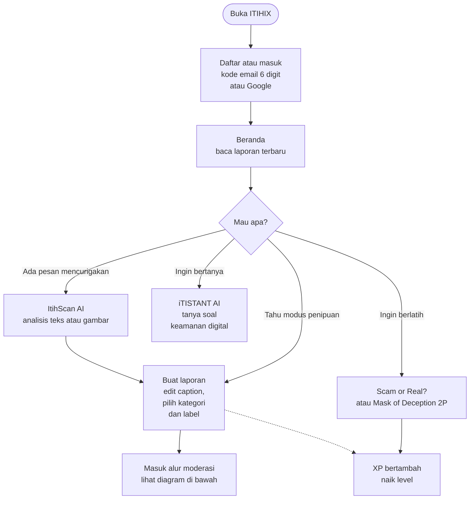

### Alur laporan dan moderasi

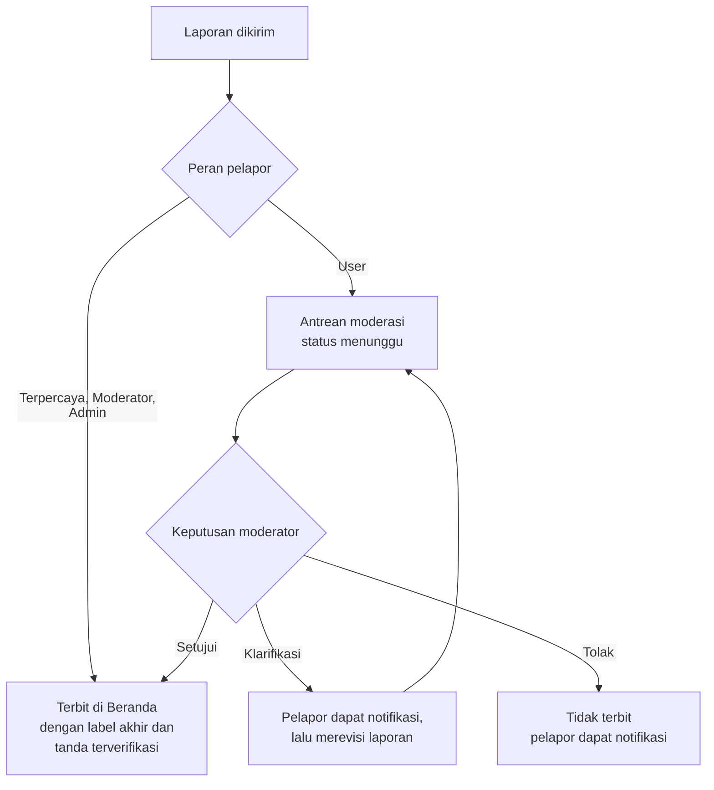

### Alur per peran

Guest adalah pengunjung yang belum masuk. Dari kiri ke kanan, kemampuan bertambah: User punya akun, Terpercaya punya semua kemampuan User, Moderator menambah wewenang moderasi, dan Admin menambah pengelolaan seluruh sistem.

| Kemampuan | Guest | User | Terpercaya | Moderator | Admin |
|---|:---:|:---:|:---:|:---:|:---:|
| Membaca laporan terbit di Beranda dan halaman detail | ✓ | ✓ | ✓ | ✓ | ✓ |
| Mendaftar atau masuk | ✓ | – | – | – | – |
| Suka, komentar, tab Mengikuti, Jelajahi, SafeSnaps | – | ✓ | ✓ | ✓ | ✓ |
| DM (syarat: [saling mengikuti](#aturan-pesan-langsung-dm)), kuis, game, ItihScan AI, iTISTANT AI | – | ✓ | ✓ | ✓ | ✓ |
| Mengirim laporan | – | ✓ | ✓ | ✓ | ✓ |
| Laporan langsung terbit (tanpa antrean) | – | – | ✓ | ✓ | ✓ |
| Lencana pada laporan | – | – | Pelapor Terverifikasi | Oleh Moderator | Oleh Admin |
| Meninjau antrean moderasi | – | – | – | ✓ | ✓ |
| Memberi atau mencabut status Terpercaya | – | – | – | ✓ | ✓ |
| Menangguhkan atau mengaktifkan akun | – | – | – | User dan Terpercaya | Semua akun |
| Menghapus laporan dan komentar orang lain | – | – | – | User dan Terpercaya | Semua |
| Menangani laporan pengguna dan komentar | – | – | – | ✓ | ✓ |
| Mengubah peran dan membuat akun | – | – | – | – | ✓ |
| Dashboard, semua laporan (hapus/pulihkan), log aktivitas | – | – | – | – | ✓ |

#### Alur Guest

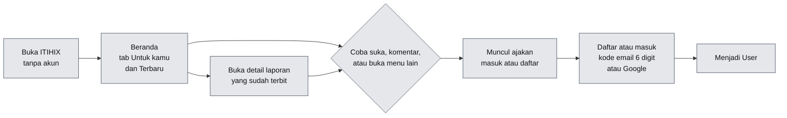

Sidebar Guest hanya berisi menu Beranda dan kartu ajakan "Gabung ITIHIX". Semua menu lain mengharuskan masuk.

#### Alur User

User punya akses ke semua menu. Alurnya dipecah per kelompok fitur supaya jelas apa yang terjadi di tiap menu.

**1. Komunitas** (Beranda, Jelajahi, SafeSnaps, Pesan, Notifikasi, Profil)

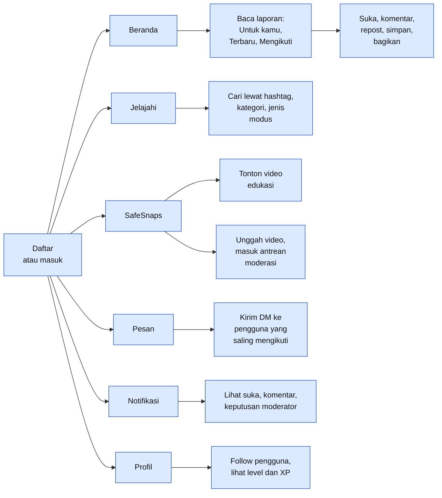

**2. Perlindungan Digital: ItihScan AI dan iTISTANT AI**

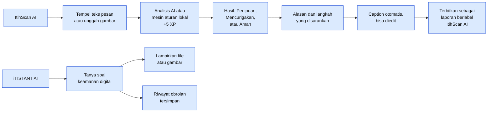

**3. Perlindungan Digital: Scam or Real? dan Mask of Deception 2P**

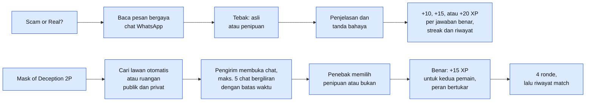

**4. Buat laporan dan laporkan pengguna**

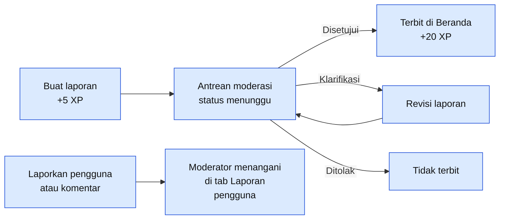

**5. Misi Harian dan XP**

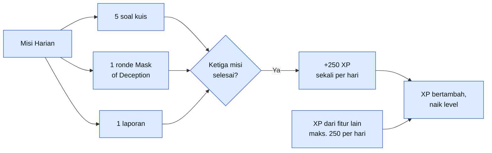

#### Alur Terpercaya

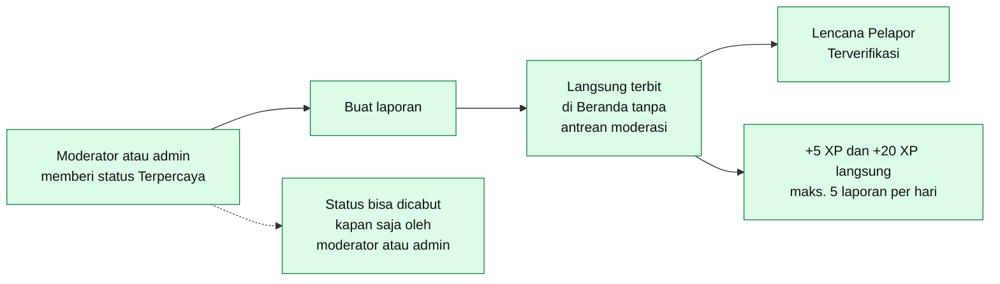

#### Alur Moderator

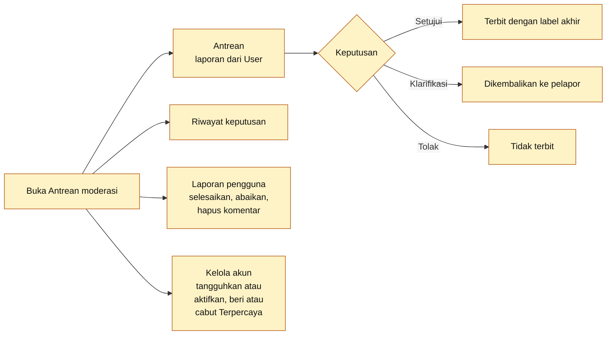

Moderator hanya bisa mengelola akun User dan Terpercaya, tidak bisa menyentuh sesama moderator atau admin.

#### Alur Admin

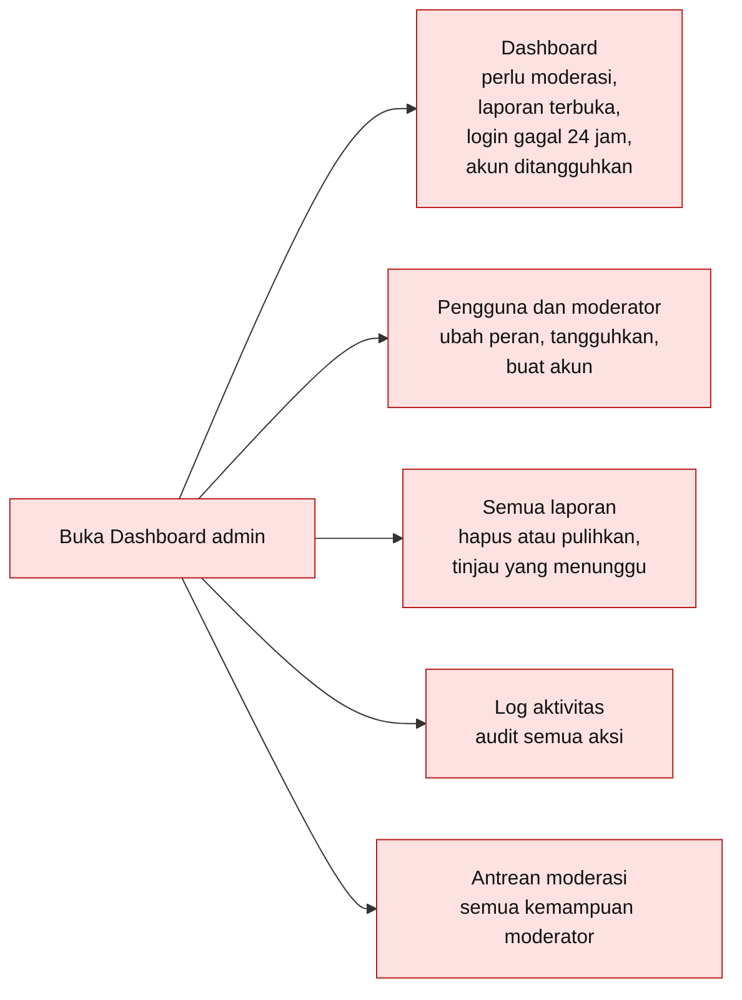

### Menu di sidebar

Sidebar dibagi menjadi lima kelompok. Menu yang tampil menyesuaikan peran: Guest hanya melihat Beranda, kelompok **Moderasi** hanya tampil untuk moderator dan admin, dan **Dashboard admin** khusus admin.

```text
ITIHIX
│
├── MENU UTAMA
│   ├── Beranda
│   ├── Jelajahi
│   └── SafeSnaps
│
├── PERLINDUNGAN DIGITAL
│   ├── ItihScan AI
│   ├── iTISTANT AI
│   ├── Scam or Real?
│   └── Mask of Deception 2P
│
├── KOMUNITAS
│   ├── Buat laporan
│   ├── Pesan
│   └── Notifikasi
│
├── MODERASI                      ← hanya moderator dan admin
│   ├── Antrean moderasi
│   └── Dashboard admin           ← hanya admin
│
└── AKUN
    ├── Profil saya
    ├── Pengaturan
    └── Keluar
```

#### Menu utama

Tempat membaca dan mencari laporan komunitas.

| Menu | Fungsi | Tampil untuk |
|---|---|---|
| **Beranda** | Feed laporan dengan tab *Untuk kamu*, *Terbaru*, dan *Mengikuti* | Semua, termasuk Guest |
| **Jelajahi** | Cari lewat hashtag, kategori, dan jenis modus | User ke atas |
| **SafeSnaps** | Feed ringkas bergaya reels untuk edukasi dan peringatan | User ke atas |

#### Perlindungan Digital

Empat fitur unggulan: dua untuk melindungi diri sekarang, dua untuk berlatih.

| Menu | Fungsi | Tampil untuk |
|---|---|---|
| **ItihScan AI** | Periksa pesan atau gambar mencurigakan | User ke atas |
| **iTISTANT AI** | Asisten obrolan soal keamanan digital | User ke atas |
| **Scam or Real?** | Kuis membedakan pesan asli dan palsu | User ke atas |
| **Mask of Deception 2P** | Game tebak penipu untuk 2 pemain | User ke atas |

#### Komunitas

Berkontribusi dan berinteraksi dengan pengguna lain.

| Menu | Fungsi | Tampil untuk |
|---|---|---|
| **Buat laporan** | Kirim laporan penipuan ([langkah lengkap](#membuat-laporan)) | User ke atas |
| **Pesan** | Pesan langsung (DM), hanya antar pengguna yang [saling mengikuti](#aturan-pesan-langsung-dm) | User ke atas |
| **Notifikasi** | Pemberitahuan aktivitas, termasuk keputusan moderator | User ke atas |

#### Moderasi

Kelompok ini tidak muncul untuk Guest, User, maupun Terpercaya.

| Menu | Fungsi | Tampil untuk |
|---|---|---|
| **Antrean moderasi** | Setujui, minta klarifikasi, atau tolak laporan | Moderator dan Admin |
| **Dashboard admin** | Kelola pengguna, peran, laporan, dan log | Admin |

#### Akun

Pengelolaan identitas dan preferensi pribadi.

| Menu | Fungsi | Tampil untuk |
|---|---|---|
| **Profil saya** | Profil, level, XP, riwayat, dan status laporanmu (tab *Pending*) | User ke atas |
| **Pengaturan** | Privasi dan preferensi | User ke atas |
| **Keluar** | Logout | User ke atas |

### Ringkasan langkah

1. Pengguna mendaftar atau masuk, lalu membaca laporan terbaru di **Beranda**.
2. Kalau menerima pesan mencurigakan, pengguna memeriksanya lewat **ItihScan AI**. Kalau hanya ingin bertanya, pakai **iTISTANT AI**. Untuk berlatih, ada **Scam or Real?** dan **Mask of Deception 2P**.
3. Hasil ItihScan AI otomatis menjadi caption laporan. Pengguna bisa mengeditnya, atau membuat laporan sendiri lewat **Buat laporan**.
4. Laporan dari User masuk **Antrean moderasi**. Laporan dari pengguna Terpercaya, Moderator, dan Admin langsung terbit.
5. Moderator memilih: **setujui** (laporan terbit dengan label akhir dan tanda terverifikasi), **minta klarifikasi** (pelapor merevisi, lalu laporan masuk antrean lagi), atau **tolak** (tidak terbit, pelapor diberi tahu).
6. Setiap aktivitas (laporan, kuis, game, komentar) menambah XP sehingga pengguna naik level.

## Coba yuk ITIHIX!

1. Buka [itihix.my.id](https://itihix.my.id), lalu **daftar** akun baru (email dikirimi kode 6 digit) atau masuk dengan Google.
2. Di **Beranda**, lihat tab *Untuk kamu* dan *Terbaru*. Laporan yang sudah diperiksa moderator bertanda terverifikasi. Tanpa akun pun kamu bisa membaca Beranda sebagai tamu.
3. Buka **ItihScan AI**, tempel pesan seperti *"Selamat! Anda menang undian Rp50 juta. Klik link ini dan transfer biaya admin"*, lalu lihat hasil analisis dan caption otomatisnya.
4. Edit caption, pilih kategori dan label, lalu kirim sebagai laporan. Laporan masuk antrean moderasi. Rincian isian dan batas file ada di [Membuat laporan](#membuat-laporan), dan cara mengecek statusnya ada di [Memantau status dan merevisi laporan](#memantau-status-dan-merevisi-laporan).
5. Di **Jelajahi**, coba cari lewat hashtag atau klik label *Penipuan*.
6. Coba **Kuis Scam or Real?** untuk mendapatkan XP, lalu ajak temanmu main **Mask of Deception 2P** (lihat [cara mainnya](#cara-main-mask-of-deception-2p)). Pantau kemajuanmu di kartu **Misi hari ini** (kolom kanan), dan selesaikan ketiga misi untuk bonus +250 XP.
7. Tanya **iTISTANT AI** hal seperti "Bagaimana cara tahu link bank palsu?".
8. Ingin mencoba DM? Follow temanmu dan minta dia follow balik dulu ([aturannya](#aturan-pesan-langsung-dm)).
9. **Khusus instalasi lokal:** untuk mencoba `moderator.php` dan `admin.php`, ubah peran akunmu lewat database (lihat langkah 8 di bagian [Menjalankan di komputer sendiri](#menjalankan-di-komputer-sendiri)). Langkah ini **tidak bisa dilakukan di website online** karena peran di sana hanya diatur admin ITIHIX.

---

## Panduan pengguna

Bagian ini untuk kamu yang memakai website (online maupun lokal). Hal-hal yang sering ditanyakan dan sebelumnya tersebar di bagian lain dikumpulkan di sini.

### Membuat laporan

Ada dua jalan:

- **Dari menu Buat laporan** (kelompok *Komunitas* di sidebar): formulir kosong.
- **Dari ItihScan AI:** setelah hasil keluar, pilih terbitkan sebagai laporan. Formulir terisi otomatis dari hasil pemeriksaan, laporan diberi label *ItihScan AI*, dan teks yang diperiksa ikut ditampilkan. Gambar dari pemeriksaan dipakai sebagai bukti kalau kamu tidak memilih file lain. Semua isian masih bisa kamu edit.

Isian formulir:

| Isian | Wajib? | Aturan |
|---|:---:|---|
| Judul laporan | Ya | 5 sampai 160 karakter. Contoh: *Modus hadiah palsu mengatasnamakan bank*. |
| Kategori | Ya | Pilih 1 sampai 3 kategori. |
| Jenis modus | Tidak | Maksimal 5. |
| Label | Ya | Pilih minimal satu: *Penipuan*, *Mencurigakan*, *Klarifikasi*, atau *Edukasi*. Untuk User, ini hanya **saran** untuk moderator. Untuk Terpercaya, Moderator, dan Admin, ini label laporan. |
| Ceritakan apa yang terjadi | Ya | Maksimal 4.000 karakter. Jelaskan isi pesan, cara pelaku menghubungi, dan tanda yang membuatmu curiga. Tulis hashtag dengan `#` (misalnya `#WaspadaAPK`), dan saran hashtag akan muncul. |
| Bukti pendukung atau poster | Tidak | Foto atau video, maksimal **10 file** per laporan. Format: JPG, PNG, WebP, GIF, MP4, WebM, MOV. Ukuran maksimal **8 MB per gambar** dan **40 MB per video**. |
| Catatan untuk moderator | Tidak | Maksimal 255 karakter. Isi dengan sumber informasi atau konteks tambahan. |

Tips sebelum mengirim:

- **Sensor data pribadi** (nomor rekening, telepon, alamat) di teks dan di tangkapan layar. Moderator akan memintamu menyensor kalau masih terlihat.
- Batas kirim: **8 laporan per jam**. Kalau terlampaui, tunggu satu jam.

Setelah dikirim, laporan User masuk antrean moderasi dengan status *Menunggu*. Laporan Terpercaya, Moderator, dan Admin langsung terbit.

### Memantau status dan merevisi laporan

**Di mana mengecek status?** Buka **Profil saya**, lalu tab **Pending** (angkanya menunjukkan jumlah laporan yang belum terbit). Di dalamnya ada filter:

| Filter | Artinya | Yang perlu kamu lakukan |
|---|---|---|
| *Menunggu* | Belum ditinjau moderator. | Tunggu. Kamu tidak perlu mengirim ulang. |
| *Perlu klarifikasi* | Moderator meminta perbaikan atau informasi tambahan. Ada penanda titik di tab Pending. | Revisi laporan (langkah di bawah). |
| *Ditolak* | Laporan tidak diterbitkan. Alasannya ada di notifikasi dan catatan moderator. | Kalau kamu punya bukti baru, buat laporan baru. |

Laporan yang disetujui hilang dari Pending dan tampil di Beranda dengan label akhir dan tanda terverifikasi. Kamu juga mendapat **notifikasi** untuk setiap keputusan moderator (menu *Notifikasi*).

**Cara merevisi setelah moderator meminta klarifikasi:**

1. Buka notifikasi *Moderator meminta klarifikasi*, atau buka **Profil saya > Pending > Perlu klarifikasi** lalu pilih laporannya.
2. Baca **Catatan moderator** yang tampil di laporan.
3. Tekan **Revisi & kirim ulang**. Formulir yang sama dengan Buat laporan terbuka dengan isi laporanmu.
4. Perbaiki sesuai catatan (misalnya sensor nomor rekening, tambahkan bukti, atau perjelas kronologi), lalu kirim.
5. Laporan kembali ke antrean moderasi dengan status *Menunggu*.

### Aturan pesan langsung (DM)

Pesan langsung sengaja dibatasi untuk mencegah spam dan penipuan lewat DM. Pesan hanya bisa **dikirim** bila semua syarat ini terpenuhi:

1. **Kalian saling mengikuti.** Kamu mengikuti dia **dan** dia mengikuti kamu. Kalau hanya satu arah, kamu akan melihat pesan *"Kamu dan @nama harus saling mengikuti untuk bisa berkirim pesan."*
2. **Penerima mengizinkan pesan.** Kalau dia mematikannya di *Pengaturan*, kamu akan melihat *"@nama sedang tidak menerima pesan."*
3. Isi pesan **1 sampai 1.000 karakter**, dan tidak bisa mengirim ke diri sendiri.
4. Tidak melewati batas **20 pesan per menit**.

Cara mulai: buka profil temanmu, tekan **Follow**, minta dia follow balik, lalu buka **Pesan**. Riwayat percakapan tetap bisa dibaca walaupun salah satu dari kalian kemudian berhenti mengikuti, tetapi pesan baru tidak bisa dikirim sampai kalian saling mengikuti lagi.

Kamu bisa mematikan penerimaan pesan di **Pengaturan > Privasi**.

### Cara main Mask of Deception 2P

Game chat untuk 2 pemain. Satu ruangan terdiri dari **4 ronde**, dan peran **bertukar tiap ronde** supaya kalian sama-sama jadi pengirim dan penebak.

**Peran**

| Peran | Tugas |
|---|---|
| **Pengirim** | Mendapat peran rahasia: penipu atau bukan. Memilih kategori yang tersedia, lalu menulis pesan pembuka (maksimal 600 karakter) dan membalas penebak (maksimal 300 karakter per balasan). |
| **Penebak** | Menguji lawan lewat pertanyaan, lalu memutuskan apakah pesan dari pengirim itu *penipuan* atau *bukan*. |

**Langkah bermain**

1. Buka menu **Mask of Deception 2P**. Tekan ikon info untuk membaca ringkasan cara bermain kapan saja.
2. **Masuk ruangan** dengan salah satu cara:
   - **Cari lawan otomatis:** sistem mencarikan pemain lain. Kalau belum ada yang ketemu, batalkan pencarian lalu buat ruangan privat dan ajak temanmu.
   - **Buat ruangan publik:** tampil di daftar *Ruangan publik* sehingga pemain lain bisa bergabung. Kodenya juga bisa dibagikan.
   - **Buat ruangan privat:** tidak tampil di daftar. Bagikan **kode ruangan** (maksimal 8 karakter, contoh `K7M2P`) ke temanmu. Temanmu memasukkannya di kolom *Gabung dengan kode*.
3. Setelah dua pemain masuk, ada **undian** yang menentukan siapa jadi pengirim lebih dulu.
4. **Ngobrol maksimal 5 chat** bergantian dengan urutan: pengirim, penebak, pengirim, penebak, pengirim. Jadi pengirim punya 3 pesan dan penebak 2 balasan.
5. **Menebak:** penebak boleh mengunci tebakan kapan saja setelah ada pesan pertama, atau menunggu sampai jatah chat habis. Pilih *penipuan* atau *bukan*, isi alasan kalau mau (opsional, maksimal 300 karakter), lalu tekan **Kunci tebakan**.
6. **Hasil ronde:** jawaban ditampilkan beserta alasan. Tebakan benar berarti **kalian berdua menang** dan masing-masing mendapat **+15 XP**. Tebakan salah berarti tanpa XP.
7. Tekan **Siap lanjut** untuk ronde berikutnya. Hitung mundur 20 detik mulai setelah salah satu pemain menekan siap. Kalau habis, ronde berikutnya mulai otomatis.
8. Setelah ronde terakhir, hasil akhir ditampilkan dan match masuk **riwayat** (30 match terakhir). Tombol **Akhiri match** menghentikan permainan kapan saja.

**Batas waktu**

| Situasi | Batas | Kalau waktu habis |
|---|---|---|
| Pengirim membuka chat | 2 menit | Ronde dilewati, tanpa XP. |
| Membalas chat | 45 detik | Giliran dilewati, dan jatah chat tetap terpakai. |
| Penebak mengunci tebakan setelah jatah chat habis | 45 detik | Dianggap salah, tanpa XP. |
| Ruangan menunggu lawan | sekitar 2 menit tanpa host aktif | Ruangan kedaluwarsa. |
| Ruangan berjalan tanpa aktivitas kedua pemain | 10 menit | Match berakhir. |

**Batas XP (anti-spam):** XP game maksimal **6 ronde per hari** untuk tiap pemain, dan maksimal **3 ronde ber-XP per hari untuk pasangan pemain yang sama**. Kalau batas tercapai, tebakan benar tetap menang tetapi tanpa XP. Menyelesaikan 1 ronde sudah cukup untuk Misi Harian.

### Kalau ada masalah

Panduan ini untuk pengguna website. Kalau kamu memasang sendiri di komputer, lihat [Masalah saat memasang di komputer sendiri](#masalah-saat-memasang-di-komputer-sendiri).

| Yang kamu lihat | Artinya | Yang bisa dilakukan |
|---|---|---|
| *"Terlalu banyak percobaan. Coba lagi dalam beberapa menit."* (saat masuk) | Terlalu banyak percobaan masuk yang gagal: batasnya 8 per akun dan 30 per perangkat/IP dalam 10 menit. | Tunggu sekitar 10 menit lalu coba lagi. Kalau lupa kata sandi, pakai **Lupa kata sandi**. |
| *"Terlalu banyak pendaftaran dari perangkat ini."* | Batas pendaftaran 5 per jam per perangkat. | Tunggu satu jam. |
| *"Terlalu banyak permintaan kode. Coba lagi nanti."* | Kamu meminta kode verifikasi terlalu sering (batas 5 per jam). | Tunggu, lalu minta sekali saja dan tunggu emailnya. |
| *"Kode salah. Sisa percobaan: n."* | Kode salah. Maksimal 5 kali salah. | Periksa angka. Kalau sisa 0 atau muncul *"Terlalu banyak kode salah"*, tekan **Kirim ulang kode** untuk kode baru. |
| Kode email tidak sampai | Email belum terkirim atau masuk folder lain. | 1) Cek folder **Spam** atau **Promosi**. 2) Pastikan alamat email benar. 3) Tunggu **60 detik** lalu tekan **Kirim ulang kode** (jeda kirim ulang 60 detik, batas 5 per jam). 4) Pakai kode yang terbaru, karena kode berlaku **10 menit**. 5) Kalau tetap gagal, coba masuk dengan Google. |
| *"Terlalu cepat, tunggu sebentar."*, *"Terlalu banyak pesan, tunggu sebentar."*, atau *"Terlalu banyak komentar, tunggu sebentar."* | Kamu menekan terlalu cepat. Ada batas per menit (komentar 10, DM 20, iTISTANT AI 15). | Tunggu satu menit lalu coba lagi. |
| *"Kamu mengirim terlalu banyak laporan."* | Batas 8 laporan per jam. | Tunggu satu jam. |
| *"Kamu mengunggah terlalu banyak video."* | Batas 6 unggahan SafeSnaps per jam. | Tunggu satu jam. |
| ItihScan AI atau kuis tidak bisa dipakai beruntun | Ada batas pemakaian: ItihScan AI 12 per 5 menit, soal kuis AI 8 per 5 menit. | Tunggu beberapa menit. |
| *"Ukuran file melebihi batas ..."* atau upload ditolak | Gambar lebih dari 8 MB, video lebih dari 40 MB, lebih dari 10 file, atau format tidak didukung. | Kecilkan atau kompres file, dan pakai JPG, PNG, WebP, GIF, MP4, WebM, atau MOV. |
| DM tidak bisa dikirim | Belum saling mengikuti, atau penerima mematikan pesan. | Lihat [Aturan pesan langsung](#aturan-pesan-langsung-dm). |
| Hasil ItihScan AI atau iTISTANT AI terasa singkat dan sederhana | Layanan AI sedang tidak aktif, sehingga dipakai mesin aturan lokal. | Tetap bisa dipakai sebagai bantuan awal. Verifikasi lewat sumber resmi. |
| Kamu keluar sendiri dan tidak bisa masuk | Akun bisa ditangguhkan oleh moderator atau admin. Akun yang ditangguhkan langsung dikeluarkan dari sesinya. | Hubungi pengelola ITIHIX untuk menanyakan statusnya. |
| Menu Moderasi atau Dashboard admin tidak ada | Menu itu hanya untuk moderator dan admin. | Itu normal untuk akun User atau Terpercaya. |

---

## Keamanan

Dibagi dua: apa yang melindungi **akun dan data pengguna**, dan apa yang melindungi **website dan servernya**.

### Keamanan pengguna

**Akun dan masuk**

| Perlindungan | Cara kerjanya |
|---|---|
| Verifikasi email | Akun baru baru dibuat setelah kamu memasukkan kode 6 digit dari email. Kode berlaku 10 menit, salah maksimal 5 kali (lalu harus minta kode baru), dan kirim ulang diberi jeda 60 detik. |
| Kata sandi | Minimal 8 karakter. Disimpan sebagai hash (`password_hash`), tidak pernah sebagai teks asli. Kode verifikasi juga hanya disimpan sebagai hash. |
| Batas percobaan masuk | Maksimal 8 percobaan per akun dan 30 per IP dalam 10 menit. Pesan galat sengaja dibuat sama, jadi orang luar tidak bisa menebak apakah suatu akun ada. Percobaan gagal dicatat di log. |
| Ubah sandi dan email | Mengganti kata sandi atau email meminta kata sandi saat ini. Email baru harus diverifikasi dengan kode lebih dulu. |
| Lupa sandi | Lewat kode 6 digit yang dikirim ke email, dengan batas permintaan per IP. |
| Login Google | Memakai `state` acak untuk mencegah pemalsuan permintaan, dan hanya menerima email yang sudah diverifikasi Google. |
| Sesi | Cookie sesi `HttpOnly`, `SameSite=Lax`, dan `Secure` di HTTPS. ID sesi diganti setiap kali masuk. Akun yang ditangguhkan langsung dikeluarkan dari sesinya. |

**Privasi dan kendali atas datamu**

- Di *Pengaturan > Privasi* kamu bisa menyembunyikan tab Repost, Disukai, dan Komentar (hanya kamu yang bisa melihat), mengatur tampilan level, dan mematikan penerimaan pesan.
- Pesan langsung (DM) hanya bisa dikirim antar pengguna yang **saling mengikuti**, dan penerima masih bisa menolak pesan lewat pengaturannya. Rincian: [Aturan pesan langsung (DM)](#aturan-pesan-langsung-dm).
- Kamu bisa menghapus laporan sendiri dan riwayat analisis ItihScan AI milikmu.
- Kamu bisa melaporkan pengguna atau komentar (penipuan, penyamaran, spam, pelecehan, konten tidak pantas). Laporan pengguna ditangani moderator.
- Moderator meminta pelapor menyensor data pribadi (nomor rekening, telepon, alamat) sebelum laporan diterbitkan.

**Yang perlu kamu lakukan**

- Jangan membagikan kode verifikasi 6 digit ke siapa pun, termasuk yang mengaku admin ITIHIX.
- Pakai kata sandi yang unik, bukan yang sama dengan akun lain.
- Sensor data pribadi di tangkapan layar sebelum mengunggah laporan.
- Jika AI aktif, teks atau gambar yang kamu kirim ke ItihScan AI dan iTISTANT AI diteruskan ke penyedia AI yang dipakai server. Jangan kirim data yang sangat sensitif.

### Keamanan website

**Aplikasi**

| Ancaman | Perlindungan |
|---|---|
| SQL injection | Semua query memakai parameter lewat PDO. |
| XSS | Teks yang tampil di halaman di-escape dengan `htmlspecialchars`. |
| CSRF | Token acak per sesi diperiksa (`hash_equals`) di semua form dan endpoint API yang mengubah data. |
| Akses tanpa izin | Setiap halaman dan API memeriksa peran di sisi server (`require_login`, `require_role`). Halaman moderator hanya untuk moderator dan admin, dashboard hanya untuk admin, dan moderator tidak bisa mengelola sesama moderator atau admin. |
| Spam dan serangan otomatis | Pembatas laju berbasis database per IP atau per pengguna (tabel di bawah). |
| Penyalahgunaan upload | Tipe file dicek dari isinya (bukan ekstensi) dan hanya JPG, PNG, WebP, GIF, MP4, WebM, dan MOV yang diterima. Nama file diacak, gambar maksimal 8 MB, video 40 MB, 10 file per laporan, dan gambar raksasa ditolak. Gambar dikompres ulang di server. |
| Eksekusi file upload | Folder `uploads/` punya `.htaccess` yang menolak PHP. Lampiran chat dikirim dengan `Content-Security-Policy: sandbox`. |
| Jejak penyalahgunaan | Aktivitas penting (masuk, gagal masuk, perubahan, moderasi) dicatat di log aktivitas beserta IP. Laporan memakai soft-delete sehingga bisa dipulihkan admin. |

**Pembatas laju (rate limit)**

| Aksi | Batas |
|---|---|
| Masuk | 8 per akun dan 30 per IP, per 10 menit |
| Daftar | 5 per jam |
| Kirim ulang kode email | 5 per jam |
| Reset kata sandi | 10 per jam per IP |
| Kirim laporan | 8 per jam |
| Unggah SafeSnaps | 6 per jam |
| Komentar | 10 per menit |
| Pesan langsung | 20 per menit |
| iTISTANT AI | 15 per menit |
| ItihScan AI | 12 per 5 menit |
| Soal kuis AI | 8 per 5 menit |
| Laporkan pengguna | 5 per jam |

**Server dan konfigurasi**

- `.htaccess` mematikan daftar isi folder (`Options -Indexes`), menolak akses ke file tersembunyi, `.sql`, `.md`, `.log`, `.bak`, `.ini`, dan memblokir folder internal (`migrations`, `docs`, `tests`, `vendor`).
- Header keamanan: `X-Content-Type-Options: nosniff`, `X-Frame-Options: SAMEORIGIN`, `Referrer-Policy`, dan `Permissions-Policy` (kamera, mikrofon, dan lokasi dimatikan).
- Kata sandi database, API key, dan kredensial SMTP hanya ada di `.env` di server (idealnya di luar web root), tidak pernah dikirim ke browser, dan tidak ikut Git (`.gitignore`).
- Untuk Nginx tersedia contoh pengaman di `docs/nginx.conf.example`.

---

## Cara kerjanya

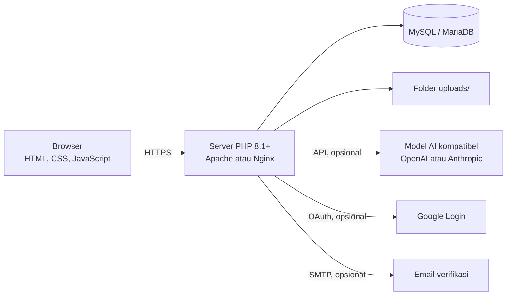

- Satu aplikasi PHP melayani halaman dan endpoint AJAX (`api/*.php`).
- API key dan kata sandi hanya ada di server (`.env`), tidak pernah dikirim ke browser.
- Data disimpan di MySQL. Perubahan skema dikelola lewat `migrations/`.
- Penyedia AI bisa diganti lewat `.env` (`AI_PROVIDER`, `AI_BASE_URL`, `AI_MODEL`) tanpa ubah kode. Tanpa API key, ItihScan AI dan iTISTANT AI memakai mesin aturan lokal.

---

## Teknologi

| Bagian | Yang dipakai |
|---|---|
| Backend | PHP 8.1+ (PDO, cURL, mbstring, fileinfo), tanpa framework |
| Database | MySQL 5.7+ / MariaDB 10.3+ |
| Frontend | HTML, CSS, JavaScript murni (tanpa framework dan tanpa CDN) |
| AI | Model kompatibel OpenAI atau Anthropic (opsional) + mesin aturan lokal |
| Login dan email | Google OAuth 2.0 (opsional), SMTP (opsional) |

---

## Isi folder

```
itihix/
├── index.php, explore.php, safesnaps.php, safesnaps_upload.php,
│   detect.php, chat.php, quiz.php, game.php, post.php, edit_report.php,
│   upload.php, profile.php, settings.php, notifications.php,
│   messages.php                           Halaman utama aplikasi
├── login.php, register.php, verify_email.php, forgot_password.php,
│   reset_password.php, google_login.php, google_callback.php,
│   logout.php                             Autentikasi
├── moderator.php, admin.php               Moderasi dan administrasi
├── api/                                   Endpoint AJAX (reaksi, komentar, chat, deteksi, kuis, game, DM, dll.)
├── includes/                              Logika inti (bootstrap, ai, posts, mail, migrate, dll.)
├── assets/                                CSS, JavaScript, dan gambar
├── migrations/                            Riwayat perubahan skema database
├── uploads/                               File unggahan pengguna (isinya tidak ikut di Git)
├── docs/                                  Contoh konfigurasi Nginx, catatan CSS, dan ikon untuk README (docs/icons)
├── database.sql                           Skema database terbaru
├── config.php                             Konfigurasi utama (membaca .env)
├── config.local.php.example               Contoh konfigurasi lokal
├── migrate.php                            Menjalankan migrasi secara manual
└── .env.example                           Contoh isi .env
```

---

## Menjalankan di komputer sendiri

Bagian ini untuk yang ingin memasang ITIHIX sendiri (developer, penguji, atau penilai). Pengguna website online tidak perlu membacanya.

Yang kamu butuhkan:

- **XAMPP atau Laragon** (sudah termasuk PHP 8.1+, Apache, dan MySQL/MariaDB). Unduh di [apachefriends.org](https://www.apachefriends.org) atau [laragon.org](https://laragon.org).
- PHP dengan ekstensi `pdo_mysql`, `fileinfo`, `curl`, dan `mbstring` (sudah aktif di XAMPP/Laragon standar).
- (Opsional) API key AI, kredensial Google OAuth, dan akun SMTP.

### Langkah-langkah

1. **Unduh kodenya.** Di halaman repo GitHub, klik tombol hijau **Code**, lalu **Download ZIP**. Atau pakai git:

   ```bash
   git clone https://github.com/ZaidAlHibb/itihix.git
   ```

2. **Taruh di web root.** Ekstrak dan salin foldernya ke `htdocs` (XAMPP) atau `www` (Laragon), sehingga namanya `htdocs/itihix`.
3. **Nyalakan Apache dan MySQL** lewat panel XAMPP/Laragon.
4. **Buat database dan impor skema.** Buka `http://localhost/phpmyadmin`, buat database baru bernama `itihix` dengan collation `utf8mb4_unicode_ci`, pilih database itu, lalu **Import** file `database.sql`.
5. **Buat file `.env`.** Salin `.env.example` menjadi `.env`, lalu isi `ITIHIX_DB_USER`, `ITIHIX_DB_PASS`, dan `ITIHIX_BASE_URL` (di XAMPP biasanya user `root`, sandi kosong, base URL `/itihix`).
   - Windows: pastikan namanya benar-benar `.env`, bukan `.env.txt`.
   - **Lebih aman:** simpan sebagai `../itihix.env` (satu tingkat di atas folder aplikasi, di luar web root), atau tunjuk lewat variabel `ITIHIX_ENV_FILE`.
6. **Pastikan folder `uploads/` bisa ditulis** oleh web server.
7. Buka **http://localhost/itihix/** di browser, lalu daftar akun baru.
8. **(Opsional, hanya untuk instalasi lokal) Jadikan akunmu admin atau moderator** lewat phpMyAdmin, tab SQL:

   ```sql
   UPDATE users SET role = 'admin' WHERE email = 'emailkamu@contoh.com';
   ```

   Nilai peran yang tersedia: `user`, `trusted` (Terpercaya), `moderator`, `admin`. Di website online, peran hanya bisa diubah oleh admin ITIHIX lewat dashboard.

### Isi file `.env`

```env
ITIHIX_DB_HOST=localhost
ITIHIX_DB_PORT=3306
ITIHIX_DB_NAME=itihix
ITIHIX_DB_USER=root
ITIHIX_DB_PASS=
ITIHIX_BASE_URL=/itihix

# AI (opsional; kosongkan AI_API_KEY = pakai mesin aturan lokal)
AI_PROVIDER=openai
AI_BASE_URL=https://api.openai.com/v1
AI_API_KEY=
AI_MODEL=

# Login Google (opsional)
GOOGLE_CLIENT_ID=
GOOGLE_CLIENT_SECRET=
GOOGLE_REDIRECT_URI=

# Email verifikasi (opsional)
SMTP_HOST=
SMTP_PORT=587
SMTP_SECURE=tls
SMTP_USER=
SMTP_PASS=
SMTP_FROM=
MAIL_DEV_LOG=0
```

| Nama | Fungsi | Wajib |
|---|---|---|
| `ITIHIX_DB_*` | Koneksi database | Ya |
| `ITIHIX_BASE_URL` | Folder URL aplikasi, tanpa slash di akhir. Kosongkan jika di root domain | Ya |
| `AI_API_KEY`, `AI_PROVIDER`, `AI_BASE_URL`, `AI_MODEL` | AI sungguhan untuk ItihScan AI dan iTISTANT AI (nama lama `ANTHROPIC_*` tetap dikenali) | Tidak |
| `GOOGLE_*` | Login Google. Redirect URI = `https://DOMAIN/google_callback.php` (contoh di server kami: `https://itihix.my.id/google_callback.php`) | Tidak |
| `SMTP_*` | Kode verifikasi email. Untuk Gmail pakai *App Password* (butuh verifikasi 2 langkah) | Tidak |
| `MAIL_DEV_LOG` | `1` = kode verifikasi ditulis ke `includes/mail.log` (hanya untuk uji lokal) | Tidak |

**Jangan pernah membagikan atau meng-commit file `.env`**, karena isinya kata sandi dan API key. File ini sudah ada di `.gitignore`.

### Masalah saat memasang di komputer sendiri

Untuk masalah saat memakai website (kode email, "terlalu banyak percobaan", DM gagal, dan sebagainya), lihat [Kalau ada masalah](#kalau-ada-masalah) di Panduan pengguna.

| Masalah | Yang bisa dicoba |
|---|---|
| Halaman tidak ditemukan atau CSS tidak muncul | Cek `ITIHIX_BASE_URL` di `.env`, harus sama dengan nama folder (mis. `/itihix`). |
| Error koneksi database | Pastikan MySQL menyala, `database.sql` sudah diimpor ke database `itihix`, dan `ITIHIX_DB_USER` dan `ITIHIX_DB_PASS` benar. |
| Upload gambar gagal | Pastikan folder `uploads/` bisa ditulis dan ukuran file tidak terlalu besar. |
| Kode verifikasi email tidak sampai | Cek isi `SMTP_*`. Untuk uji lokal isi `MAIL_DEV_LOG=1`, lalu baca kodenya di `includes/mail.log`. |
| ItihScan AI hanya memberi jawaban singkat | `AI_API_KEY` kosong atau salah, jadi dipakai mesin aturan lokal. |

---

## Migrasi database

- Perubahan skema = tambah file `migrations/NNN_deskripsi.php` (idempoten), lalu naikkan `SCHEMA_VERSION` di `config.php`.
- Migrasi tertunda dijalankan otomatis (sekali per sesi baru) atau manual: `php migrate.php`.
- `database.sql` berisi skema terbaru untuk instalasi baru.
- Soal kuis tidak ada di `database.sql`; aplikasi menyiapkannya sendiri saat fitur kuis dipakai (`api/quiz.php`).

---

## Deploy

ITIHIX adalah aplikasi PHP + MySQL dengan file upload, jadi butuh hosting yang mendukung PHP dan database MySQL (shared hosting, VPS, atau container Docker PHP). Platform serverless seperti Vercel tidak cocok karena tidak menjalankan PHP secara native dan tidak menyimpan file upload secara permanen.

1. Buat database di hosting dengan **user khusus** (jangan `root`) dan sandi kuat, lalu impor `database.sql`.
2. Upload kode (tanpa `.env`).
3. Buat `.env` **langsung di server**, idealnya di luar web root sebagai `../itihix.env`. Pastikan `MAIL_DEV_LOG=0`.
4. Pastikan `uploads/` bisa ditulis dan `uploads/.htaccess` ikut ter-upload.
5. Aktifkan **HTTPS**. Jika memakai login Google, perbarui `GOOGLE_REDIRECT_URI` ke domain asli.
6. Untuk Nginx, pakai contoh pengaman di `docs/nginx.conf.example`.

---

## Keterbatasan

- Tanpa API key, ItihScan AI dan iTISTANT AI memakai mesin aturan lokal yang lebih sederhana dan tidak sepintar model AI.
- Hasil analisis AI adalah **bantuan**, bukan kepastian. Selalu verifikasi lewat sumber resmi (bank, instansi, atau nomor resmi) sebelum mengambil tindakan.
- Penyedia AI punya batas permintaan, dan ITIHIX membatasi pemakaian per hari lewat rate limit.
- Pengiriman email bergantung pada konfigurasi SMTP (mis. Gmail App Password).
- Belum ada verifikasi dua langkah (2FA) untuk login.
- Belum ada tes otomatis; alur utama (login, unggah, kuis, ItihScan AI) diuji manual.

---

## Sumber daya pihak ketiga dan lisensi

Penggunaan template, framework, library, aset, maupun kode sumber pihak ketiga dilakukan sesuai lisensi masing-masing. Sumber daya yang signifikan dicantumkan di bawah ini.

| Sumber daya | Kegunaan | Lisensi | Keterangan |
|---|---|---|---|
| PHP dan MySQL/MariaDB | Bahasa server dan basis data | PHP License / GPL | Runtime, bukan kode yang disalin |
| [Font Awesome Free 6](https://fontawesome.com) | Pustaka ikon. Ikon yang dipakai disalin sebagai SVG inline (`includes/icons.php`, `assets/js/icons.js`) | Ikon: [CC BY 4.0](https://fontawesome.com/license/free) | Atribusi: Font Awesome by Fonticons, Inc. Ikon dipilih sebagian dan diwarnai lewat `currentColor`. Ikon fitur dan ikon peran di README (`docs/icons/*.svg`) juga berasal dari sini, diberi warna hitam dan latar putih |
| [Lucide](https://lucide.dev) | Pustaka ikon. Ikon yang dipakai disalin sebagai SVG inline di SafeSnaps (`safesnaps.php`) | [ISC](https://github.com/lucide-icons/lucide/blob/main/LICENSE) | Hak cipta: Lucide Contributors (dan Cole Bemis untuk bagian turunan Feather) |
| Google OAuth 2.0 / OpenID Connect | Login dengan Google (opsional) | Ketentuan layanan Google | Layanan eksternal via API |
| Penyedia AI kompatibel OpenAI atau Anthropic | ItihScan AI dan iTISTANT AI (opsional) | Ketentuan penyedia API | Layanan eksternal |
| SMTP (mis. Gmail) | Kode verifikasi email (opsional) | Ketentuan penyedia | Layanan eksternal |

Catatan:

- Aplikasi **tidak memakai framework PHP/JS/CSS** dan tidak memasang paket lewat npm atau Composer. Tidak ada library, font, atau stylesheet yang dimuat lewat CDN; JavaScript dan CSS ditulis sendiri (`assets/js`, `assets/css`).
- **Pengecualian: ikon.** Ikon Font Awesome dan Lucide tetap pustaka pihak ketiga. Bedanya, ikon yang dipakai disalin ke kode sebagai SVG inline, bukan dimuat dari luar, jadi lisensi dan atribusinya dicantumkan di tabel di atas.
- Pengiriman email (SMTP), migrasi, rate limit, dan seluruh logika aplikasi ditulis sendiri oleh tim.
- Logo dan ikon fitur di `docs/icons/*.png` adalah salinan kecil dari `assets/img/` (diberi latar putih supaya terlihat di tema gelap GitHub).
- Aset gambar di `assets/img/` (`logo.png`, `iTIHSCAN.png`, `iTISTANT_Ai.png`, `mod2p.png`, `sor.png`): **[dibuat sendiri oleh tim]**
- Alat bantu pengembangan (mis. asisten AI) yang dipakai membuat kode atau aset: **Claude untuk Asisten Kode, Chat GPT untuk Asisten UI/UX, Gemini untuk Asisten brainstorming**

Kode ITIHIX sendiri dirilis dengan lisensi [MIT](LICENSE).

## Dokumentasi

- `README.md` (file ini): fitur utama, cara menjalankan, panduan penggunaan, peran, level, dan keamanan.
- Dokumentasi teknis pendukung: `database.sql` (skema basis data), `migrations/` (riwayat skema), `docs/nginx.conf.example` (konfigurasi Nginx), serta `.env.example` dan `config.local.php.example` (contoh konfigurasi).